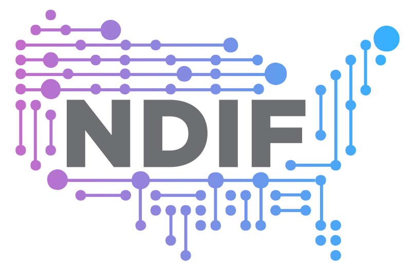

<p align="center">
  
</p>

<h3 align="center">
National Deep Inference Fabric
</h3>

<p align="center">
<a href="https://ndif.us"><b>Website</b></a> | <a href="https://nnsight.net"><b>nnsight</b></a> | <a href="https://discord.gg/6uFJmCSwW7"><b>Discord</b></a> | <a href="https://arxiv.org/abs/2407.14561"><b>Paper</b></a>
</p>

---

**NDIF** is the server backend for [**nnsight**](https://nnsight.net). It runs
user-submitted intervention code — hooks, captures, edits, generation — against
large models on a shared GPU cluster. Researchers point nnsight at an NDIF
endpoint and run experiments on models too big to fit on their own hardware.

With no authentication configured — the default — a request that doesn't specify
`trusted` is trusted, and its code runs inside the model process; an explicit
`trusted: false` is honored. An untrusted request's code runs in a separate
process, one fresh process per request, when the deployment uses the sandboxed
model actor, which the compose stack sets and the published image and a
from-source install do not (`NDIF_DEFAULT_MODEL_ACTOR_CLASS`; see
[docs/operating/compose-stack.md](docs/operating/compose-stack.md)). That is
process separation, not a security boundary — see
[docs/concepts/sandbox-execution.md](docs/concepts/sandbox-execution.md).

This repo is the server. For the client, see
[nnsight](https://github.com/ndif-team/nnsight); it is an ordinary dependency
here, and `just up` bind-mounts an editable local checkout over it for client-side
development.

---

## Installation

The server is published two ways; both carry the same code.

```bash
docker pull ndif/ndif                 # the whole stack in one image (needs the NVIDIA container toolkit)
pip install "ndif[api,ray]"           # the package and the ndif CLI, for running it as host processes
```

A bare `pip install ndif` is only the package and the `ndif` CLI — enough for
`ndif doctor`, `version`, `queue` and `kill`, not for running a server or
talking to one (`deploy`, `status`, `evict` need the Ray client). The `api` and
`ray` extras add the two services and that client. torch is not a dependency of the
package because the right wheel depends on your CUDA driver — install it first
from the matching PyTorch index (`cu126` for any 12.x driver). Both routes, with
the checks that prove they work, are below.

## Quick start

Three ways to stand up your own NDIF. All three need an NVIDIA GPU and a CUDA
driver; the container routes also need the NVIDIA container toolkit.

**Trust default:** with no `NDIF_POSTGRES_URL` the API is unauthenticated, and an
unspecified `trusted` defaults to trusted — the submitted block executes in-process
next to the model weights and models load with `trust_remote_code`; an explicit
`trusted: false` is honored. That is the intended default for running one for
yourself. Before anyone else can reach it, work through
[docs/runbooks/enable-auth.md](docs/runbooks/enable-auth.md).

### 1. `docker run` — the published image, whole stack in one container

```bash
docker run -d --name ndif --gpus all --shm-size 4g \
  -p 127.0.0.1:8001:8001 -p 127.0.0.1:9000:9000 \
  -v ~/.cache/huggingface:/root/.cache/huggingface \
  ndif/ndif:0.1.0
docker logs -f ndif
```

`NDIF_SERVICE` defaults to `all`, so the container starts redis, rustfs, ray and
the API together. 8001 is the API; 9000 is the object store, which the client
downloads results from, so publish it too. Tags: `0.1.0-cu126`, `0.1.0-cu130`,
`0.1.0` (= cu126) and `latest`; pick the CUDA line your driver supports. The
entrypoint is the `ndif` CLI, so any other command works the same way:

```bash
docker run --rm ndif/ndif:0.1.0 version     # ndif, nnsight, torch+CUDA, transformers, ray
docker run --rm --gpus all ndif/ndif:0.1.0 doctor
```

### 2. Docker Compose — the development stack, built from this checkout

Each service in its own container, next to Postgres and the full telemetry set
(Loki, InfluxDB, Prometheus, Grafana). [`just`](https://github.com/casey/just)
wraps the compose commands.

```bash
just up            # build (first time) + start the whole stack, detached
just logs api      # follow a service's logs
just ta            # down -> rebuild -> up, after a source change
just down          # tear it down
```

### 3. From source — the `ndif` CLI, no Docker

No checkout needed — the package is on PyPI:

```bash
pip install torch --index-url https://download.pytorch.org/whl/cu126   # first, or pip picks PyPI's default (CUDA 13) wheel
pip install "ndif[api,ray]"                                              # add metrics,postgres,dashboard as you need them
conda install --override-channels -c conda-forge redis-server
# rustfs: a release from https://github.com/rustfs/rustfs/releases on PATH
ndif doctor        # versions, binaries, GPU, connectivity
ndif start         # redis, rustfs, ray, api — detached
ndif stop          # ...and back down, Ray daemons included
```

From a checkout, `pip install -r requirements.txt` first gives you the pinned
dependency set the image is built from, then `pip install ".[api,ray]"`.
Other ways to get a `rustfs` binary are in
[docs/operating/cli.md](docs/operating/cli.md#ndif-doctor).

### Then run a remote trace

```python
import nnsight
nnsight.CONFIG.API.HOST = "http://localhost:8001"

from nnsight.modeling.transformers import TransformersModel
model = TransformersModel("openai-community/gpt2", task="text-generation")

with model.trace("The Eiffel Tower is in the city of", remote=True):
    hidden = model.transformer.h[-1].output.save()
```

No API key is needed; the first request for a model deploys it. Deeper detail for
all three routes is in [docs/operating/quickstart.md](docs/operating/quickstart.md).

## What's running

`just ps` lists the compose stack. The NDIF pieces:

| Service | Where | What |
|---|---|---|
| `api` | `localhost:8001` | Accepts nnsight requests, queues them, streams results back. |
| `ray` | GPU node | Loads models and runs the traced blocks (plain detached Ray actors — NDIF does not use Ray Serve). |
| `dashboard` | `localhost:8081` | Deploy/evict/status, schedules, request monitor. Compose only; not part of `NDIF_SERVICE=all`. |

Redis, RustFS (object store), Postgres (API-key auth), and Loki/InfluxDB/Grafana
(telemetry) round out the compose file; see `docker/docker-compose.yml`.

## Development

```bash
just ta              # down -> rebuild -> up (full refresh after a code change)
just build ray && just up ray   # rebuild and recreate one service, leaving the rest up
pytest tests/        # live-server tests skip unless the stack is up
```

Every `just ta` starts with a bare `just down`: `just ta <svc>` tears the **whole** stack down and brings back only that service and its dependencies; HOT deployments are lost.

The `ndif` CLI is the image entrypoint (`ENTRYPOINT ["tini", "-s", "--", "ndif"]`,
`CMD ["start", "--foreground"]`); `NDIF_SERVICE` selects which service(s) a container runs. It
accepts a space/comma list, and `all` expands in place — `"all dashboard"` is the
core stack plus the admin UI. Configuration is read from the environment (see the
`environment:` blocks in the compose file).

Documentation starts at [docs/index.md](docs/index.md); agents start at
[CLAUDE.md](CLAUDE.md). Contributing: [CONTRIBUTING.md](CONTRIBUTING.md).

## Configuration

Everything is configured through `NDIF_*` environment variables; there is no
config file. Each service reads its own variables at startup with a working
single-host default, so a bare `just up` runs end to end with none set, and an
empty URL for an optional provider (Postgres, Loki, InfluxDB) turns it off. Set
them in the compose `environment:` blocks, a `.env` file, or the shell.

Every variable, its default and its reader:
[docs/reference/env-vars.md](docs/reference/env-vars.md). How they layer and which
must change off a single host: [docs/operating/configuration.md](docs/operating/configuration.md).

## Using NDIF from an LLM agent

Give an agent up-to-date knowledge of running and operating NDIF one of these
ways:

- **Skills** — in Claude Code: `/plugin marketplace add https://github.com/ndif-team/skills.git`
  then `/plugin install ndif@ndif-team` (the `nnsight` plugin from the same
  marketplace covers the client side). In OpenAI Codex:
  `skill-installer install https://github.com/ndif-team/skills.git`.
- **Context7 MCP** — add `use context7` to prompts, or point your MCP client at
  `https://mcp.context7.com/mcp` (see [Context7](https://github.com/upstash/context7)).
- **Docs in context** — hand the agent [CLAUDE.md](./CLAUDE.md), which routes by
  task into [docs/](./docs/); every page there cites the source it describes.

## Contributing

PRs welcome, against `dev` — see [CONTRIBUTING.md](CONTRIBUTING.md) and the
[Code of Conduct](CODE_OF_CONDUCT.md).

## License

[MIT](LICENCE) © Northeastern University.

## Citation

```bibtex
@article{fiottokaufman2024nnsightndifdemocratizingaccess,
      title={NNsight and NDIF: Democratizing Access to Foundation Model Internals},
      author={Jaden Fiotto-Kaufman and Alexander R Loftus and Eric Todd and Jannik Brinkmann and Caden Juang and Koyena Pal and Can Rager and Aaron Mueller and Samuel Marks and Arnab Sen Sharma and Francesca Lucchetti and Michael Ripa and Adam Belfki and Nikhil Prakash and Sumeet Multani and Carla Brodley and Arjun Guha and Jonathan Bell and Byron Wallace and David Bau},
      year={2024},
      eprint={2407.14561},
      archivePrefix={arXiv},
      primaryClass={cs.LG},
      url={https://arxiv.org/abs/2407.14561},
}
```
