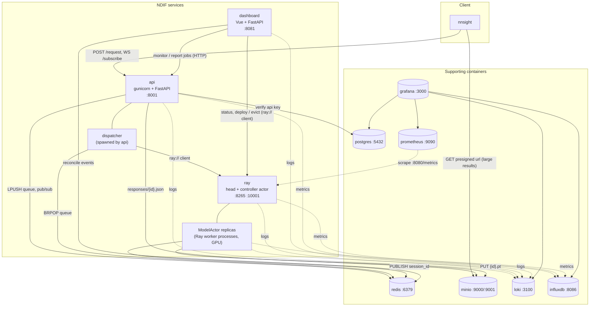

# Services and Topology

## What this covers

Everything `just up` starts, and the wiring between it. Two facts explain the
shape:

1. **One image, one service per container.** `docker/Dockerfile` builds a single
   image whose entrypoint is the `ndif` CLI, running `start --foreground`;
   `NDIF_SERVICE` picks which service that container becomes — `api`, `ray`,
   `dashboard`, `redis`, `minio`, or a list of those
   (`src/ndif/cli/service.py` `env_services`). The image's default is `all`,
   which expands to the core stack — redis, minio, ray, api, but not dashboard —
   in one container; compose sets one name per container instead. Every knob is
   an `NDIF_*` env var read at process start.
2. **The API and the Ray cluster never speak directly.** The API talks to Redis;
   a separate dispatcher process (spawned by the API's gunicorn master) holds
   the one Ray client connection. Redis is therefore the load-bearing hop for
   both request handoff and status delivery, and `ray:connected` — a flag the
   dispatcher maintains — is how the API knows whether the cluster is reachable.

## Topology

## The three NDIF services

**`api`** — `gunicorn` with uvicorn workers serving
`ndif.services.api.app:app` (`src/ndif/services/api/start.sh`). It accepts
requests, authenticates them, pushes them onto Redis, and forwards status
updates over `/subscribe` websockets. Its gunicorn master also *spawns* the
queue dispatcher as a separate process (`src/ndif/services/api/gunicorn_conf.py`
`on_starting`) — that process drains the Redis queue and holds the Ray
connection. Popped requests live in the dispatcher's memory; nothing else in the
API holds state.

**`ray`** — a Ray node plus, on the head, the NDIF controller
(`src/ndif/services/ray/start.sh`). `NDIF_RAY_HEAD_ADDRESS` decides head vs
worker: unset starts a head and launches the controller; set joins that address
as a worker. Model replicas are detached Ray actors the controller creates on
GPU nodes — plain Ray actor placement, not Ray Serve. The container needs a GPU,
the NVIDIA container toolkit, and a raised `shm_size` (Ray's plasma store lives
in `/dev/shm`).

**`dashboard`** — an admin UI (Vue) over a FastAPI backend: deploy/evict,
status, schedules, and a request monitor (`src/ndif/services/dashboard/start.sh`).
It reads controller status and deploys or evicts over its own Ray client
connection, not through the API; its cron jobs (monitor, report) call the API
over HTTP. It is the only service excluded from a bare `ndif start`
(`OPTIONAL_SERVICES` in `src/ndif/cli/service.py`), and the only one with a named
compose volume.

Image tags, published ports, dependencies and volumes for every container are in
[Compose stack](../operating/compose-stack.md#the-services); every port,
including the internal Ray ones compose does not publish, is in
[Ports](../reference/ports.md).

## What holds state

- **Redis** — the request list (`NDIF_QUEUE_KEY`, default `queue`), the
  `ray:connected` flag, the TTL'd `/status` and `/env` caches, the CLI event
  stream, and every response pub/sub channel. The compose file declares no
  volume for it, so it is purely ephemeral; losing it loses in-flight requests.
- **MinIO** — result blobs (`{request_id}.pt`) and non-blocking status responses
  (`responses/{id}.json`) in the `ndif-results` bucket. Also no compose volume:
  results do not survive `just down`.
- **Postgres** — users, API keys, and their tags. Schema from
  `docker/postgres/init.sql`; no seed data.
- **Loki / InfluxDB / Prometheus** — logs and time series, again with no compose
  volumes in the dev stack.
- **`dashboard_data`** — the one named volume, holding the dashboard's logs,
  `schedule.json`, and cache.

Everything on the NDIF side (api, ray, controller state) is in-memory and
rebuilt on restart. The controller's cluster model is *not* persisted; it
re-reads nodes from Ray and re-pins `NDIF_DEPLOYMENTS` on boot.

## What degrades without what

| Missing | Effect |
|---|---|
| `postgres` / `NDIF_POSTGRES_URL` unset | Auth is off: every request is accepted, and one that does not say otherwise is trusted. See [Auth and Limits](auth-and-limits.md#the-trusted-flag). |
| `loki` / `NDIF_LOKI_URL` unset | Fail-open: services keep running, logs go to console only. |
| `influxdb` / `NDIF_INFLUX_ENABLED=false` | Fail-open: no metric points recorded. |
| `prometheus`, `grafana` | No dashboards; nothing else notices. |
| `minio` unreachable | Results over the inline cap error at upload after the run; non-blocking requests have nowhere to write or read status. |
| `ray` down, dispatcher reconnecting | The dispatcher clears `ray:connected`, and `/request`, `/status`, `/env`, `/connected` all 503 (`require_ray_connection` in `src/ndif/services/api/app.py`). |
| dispatcher process dead, or its Ray connection dead without an error reaching it | `ray:connected` has no TTL and stays set. Health endpoints pass and `POST /request` returns `RECEIVED`, while requests never progress. |
| `redis` down | The API cannot enqueue and the dispatcher cannot pop; nothing works. |

> **Gotcha:** every provider defaults to `localhost`. Inside the `ray` container
> `localhost` is the ray container itself, and Redis is a different container —
> which is why compose sets `NDIF_REDIS_URL: redis://redis:6379` explicitly on
> the ray service. A model actor that can't reach Redis runs the job and then
> fails to publish its result. See
> [Compose stack](../operating/compose-stack.md#service-names-not-localhost).

## Related

- [Request Lifecycle](request-lifecycle.md) — the same boxes, traced by a single
  request.
- [Compose stack](../operating/compose-stack.md) — the compose file service by
  service: volumes, GPU requirements, service-name addressing.
- [Production](../operating/production.md) — what changes when the Ray cluster is
  multi-node and the object store is real S3.
- [Ports](../reference/ports.md) — every port, published or internal.
