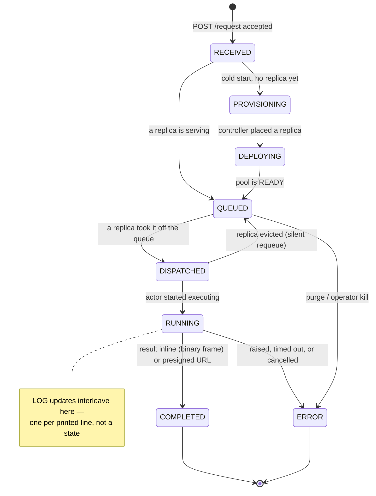

# Status and Results

## What this covers

What a user actually observes while a remote job runs, and how the saved values
get home. Two facts frame it:

1. **The status enum is the client's enum.** `BackendResponseModel` subclasses
   nnsight's `ResponseModel` and `Status` comes from nnsight
   (`src/ndif/common/schema/response.py`), so the wire format is by construction
   exactly what the client parses — see
   [nnsight integration](../developing/nnsight-integration.md#what-ndif-re-exports).
2. **A status update is small; a result may not be.** Every update is a message
   on a Redis pub/sub channel. A result under the inline cap rides on the
   `COMPLETED` message itself, as a binary frame; a larger one goes to the object
   store and `COMPLETED` carries a presigned URL to it.

## The lifecycle

| Status | Published by | When |
|---|---|---|
| `RECEIVED` | API, returned over HTTP | the request was accepted and pushed to Redis |
| `QUEUED` | `Processor.enqueue` / `Processor.reply` | joined a model's queue; description carries the position |
| `PROVISIONING` | `Processor.reply` | no replica exists; the controller is being asked for one |
| `DEPLOYING` | `Processor.reply` | a replica exists and is coming up |
| `DISPATCHED` | `Replica.dispatch` | handed to a specific actor |
| `RUNNING` | model actor (`BaseModelDeployment.run`) | execution started |
| `LOG` | model actor | one line the block printed (`LogStream` in `src/ndif/services/ray/deployments/modeling/util.py`) |
| `COMPLETED` | model actor | `data` is the result itself, or a presigned URL to download it — see below |
| `ERROR` | any of the above | terminal failure; `description` is the message |

`RECEIVED` is the only status the client gets over HTTP — it's the body of the
`POST /request` response. Everything after it arrives asynchronously.

Statuses are not strictly monotonic. A cold start goes straight from `RECEIVED`
to `PROVISIONING` and reaches `QUEUED` only once the pool is serving, and an
evicted replica silently pushes a request from `DISPATCHED` back to `QUEUED` —
with no error, so a user can legitimately see `QUEUED` twice.

## Advance vs. publish

Two methods on `BackendRequestModel` (`src/ndif/common/schema/request.py`) do
related but different jobs:

- `BackendRequestModel.response` *advances* the request's lifecycle state and
  builds the response object. Advancing is what emits telemetry:
  `_advance_status` records how long the previous phase lasted as a
  `RequestStatusTimeMetric` point and logs one structured lifecycle event. It
  ignores `LOG` and a repeat of the current status, so a chatty block's prints
  don't reset the phase clock.
- `BackendRequestModel.respond` / `arespond` call `response` and then *deliver*
  it. `arespond` is the async form the queue's workers use; the model actor uses
  the sync one.

## Two delivery routes

**Blocking (`session_id` set).** The client opened `/subscribe` first and got a
server-minted `session_id`; each response is `PUBLISH`ed to the Redis channel of
that name. A status update is JSON. A `COMPLETED` carrying the result is a
short notice naming a Redis key that holds its `torch.save` bytes. The API's
websocket handler forwards JSON as a text frame and, after `GETDEL`ing a
notice's key, the bytes as a binary frame (`src/ndif/services/api/app.py`
`subscribe`). Nothing is stored: an update published while no one is listening
is lost, which is why the API subscribes *before* handing out the session id.

**Non-blocking (no `session_id`).** There is no live channel, so each response
(except `LOG`) is written as JSON to `responses/{id}.json` in the object store,
overwriting the previous one. The client polls `GET /response/{id}`, which
returns the stored JSON or 404 if nothing has landed yet. Only the *latest*
status is available — intermediate transitions are not replayed.

Publishing mechanics are in [The Redis layer](../developing/redis-layer.md#response-publishing).

## How the result gets back

The saved values are whatever the user marked with `.save()` — anything from a
few kilobytes to many gigabytes of tensors. Both routes start the same way:

1. `execute` returns `torch.save`d bytes, with CUDA tensors relocated to CPU by
   a custom pickle module.
2. `BaseModelDeployment.prepare_result` zstd-compresses them if the request
   asked for compression and records a `RequestResponseSizeMetric`, so the blob
   is byte-identical whichever route it takes.

Then `BaseModelDeployment.run` picks a route against the **inline cap**,
`RedisProvider.max_publish_bytes` (`src/ndif/common/providers/redis.py`):

**On the response.** A blocking request whose blob is at or under the cap gets
it as `data` on the `COMPLETED` response. The response's `torch.save` bytes are
stored under the Redis key `result:{id}` (10 minute TTL) and only `RESULT_NOTICE`
plus that key is published, because Redis delivers an 8 MiB pub/sub message about
15x slower than a `GET` of the same bytes. `/subscribe` `GETDEL`s the key and
forwards the bytes as a binary frame. The client loads it directly, with no second round
trip. Most traces take this route.

**Through the object store.** Over the cap, or for a non-blocking request,
`upload_bytes` PUTs the blob at `{request.id}.pt` and `presigned_get` signs a GET
URL valid for one hour, using the *public* endpoint
(`NDIF_OBJECT_STORE_PUBLIC_URL`) rather than the server-side one. That URL rides
on `data` instead, in a JSON frame, and the client downloads it.

Either way the client decompresses, `torch.load(..., map_location="cpu")`, and —
on the blocking path — pushes the values back into the caller's frame so
`h = ....save()` populates.

**Why the cap exists, and where it comes from.** A pub/sub subscriber whose
output buffer exceeds Redis's `client-output-buffer-limit pubsub` is
disconnected, and the message goes with it: the job reads `COMPLETED` on the
server while the client never receives the result, which was never written to
the object store. So the cap is derived from the server's own limits rather than
configured beside them: `max_publish_bytes` reads them with `CONFIG GET` once per
process and takes `min(soft, hard // 2)`, counting each bound only when enabled.

| Redis configuration | Inline cap |
|---|---|
| stock redis:7 (32 MiB hard, 8 MiB soft) | 8 MiB |
| no pubsub limits configured | 20 MiB |
| `CONFIG GET` fails (managed Redis) | 8 MiB |

To raise the cap, raise the Redis pubsub limits — the cap follows. The soft limit
is the primary bound because Redis's buffer accounting carries an
allocator-dependent overhead over the payload (the reasoning is in the
`max_publish_bytes` docstring).

The inline result itself no longer crosses pub/sub (only its notice does), so
the pubsub output-buffer limits the cap is derived from do not bound it any more;
the cap is kept as the size limit for the inline route.

> **Gotcha:** a presigned URL is an HMAC over the request *including the host*.
> If `NDIF_OBJECT_STORE_PUBLIC_URL` isn't the address the client can actually
> reach, jobs complete and then fail at download. In compose it is
> `http://localhost:9000` while the server uploads to `http://minio:9000`.

Nothing deletes result blobs or `responses/*.json`: no TTL, no lifecycle rule,
no cleanup job. Expiring them is a bucket-policy concern; see
[Production](../operating/production.md).

## What the client does with each status

The client renders every update as one in-place status line. Beyond display:

- `LOG` — printed as output from the remote block, not a lifecycle change.
- `ERROR` — raises `RemoteError` with the server's `description`. For a failure
  inside the user's block that is a traceback ending at the user's line.
  `BaseModelDeployment.format_error` strips only nnsight's frames and those of
  its own file; the asyncio, Ray and other NDIF wrapper frames stay, as do the
  torch/transformers frames above the user's line.
- `COMPLETED` — takes the result off the frame or downloads the URL, and ends
  the wait.

A non-blocking client sees the same statuses through `poll()`, one snapshot at a
time.

## Related

- [Request Lifecycle](request-lifecycle.md) — which component emits each status
  and where it sits in the path.
- [Schemas](../reference/schemas.md) — `BackendRequestModel`,
  `BackendResponseModel`, and the `Status` enum field by field.
- [Redis keys](../reference/redis-keys.md) — the response channels and every
  other key involved.
- [Error messages](../reference/error-messages.md) — mapping what the user sees
  in nnsight back to a server-side cause.
