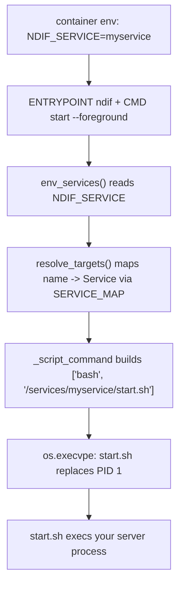

# Adding a Service

## What this covers

How to add a long-running NDIF service next to `api`, `ray` and `dashboard`, and
the single home for how any service ships its non-Python files and dependencies.
The design rests on one idea:

> **A service is a name plus a `start.sh`.** One image runs all of them;
> `NDIF_SERVICE` picks which; the CLI turns that name into a script to exec.

So adding a service is mostly *registration*, and the places you must register it
are the places that break if you forget.

## The contract



**`NDIF_SERVICE`** is a space- or comma-separated list of service names, read by
`src/ndif/cli/service.py` `env_services`. It is also the `service` label on every
log and metric, so pick the name you want to see in Grafana. The image defaults it
to `all`, which `resolve_targets` expands to what a bare `ndif start` brings up: the
`SERVICES` list (redis, minio, ray, api), or just `ray` on a worker node where
`NDIF_RAY_HEAD_ADDRESS` is set. An optional service is never in that expansion, so a
container running yours sets `NDIF_SERVICE: myservice`, or `"all myservice"` to add
it to the core stack in one container.

**`start.sh`** is the only launch surface. Every knob is env-driven, so
`_script_command` builds literally `["bash", "<package>/services/<name>/start.sh"]`
with no arguments. Your script owns defaults, validation, and the final `exec`.

**Registration** in the CLI's service list gives you `ndif start`, `stop`,
`restart` and `logs` for free, detached (PID file under `$NDIF_HOME`) and
`--foreground` (container).

## Step 1 — the package and its `start.sh`

```
src/ndif/services/myservice/
├── __init__.py
├── start.sh
└── app.py        (or whatever your service actually is)
```

```bash
#!/bin/bash
#
# Start the NDIF <myservice>: <one line on what it runs>.
#
# Env: NDIF_MYSERVICE_PORT (8090), NDIF_MYSERVICE_WORKERS (1).
set -euo pipefail

# Telemetry: label everything this service emits as `service=myservice`.
export NDIF_SERVICE="${NDIF_SERVICE:-myservice}"

# exec so the server replaces the shell (PID 1) and gets signals directly.
exec python -m uvicorn ndif.services.myservice.app:app \
    --host 0.0.0.0 --port "${NDIF_MYSERVICE_PORT:-8090}"
```

All four conventions are load-bearing: `set -euo pipefail`; export `NDIF_SERVICE`
first (`src/ndif/services/ray/start.sh` does it before `ray start` so every actor
inherits the label); `exec` the final process, because in `--foreground` mode a
single service is `execvpe`'d and `start.sh` *is* PID 1 — without `exec` your server
never sees SIGTERM; and document the env vars with defaults in the header comment.

Anything that isn't the foreground process goes *before* the `exec`, guarded so a
laptop run degrades instead of failing — `src/ndif/services/dashboard/start.sh`
starts cron for its scheduled jobs only if `cron` is on `PATH` and `/etc/cron.d` is
writable.

## Step 2 — register it with the CLI

`src/ndif/cli/service.py` holds two lists:

```python
# The core stack, ordered by startup dependency. `ndif start` with no args
# walks this list; `ndif stop` reverses it.
SERVICES: list[Service] = [
    Service("redis", _redis_command, "Redis (request queue + response pub/sub)"),
    Service("minio", _minio_command, "MinIO object store (execution results)", _minio_env),
    Service("ray", _script_command("ray/start.sh"), "Ray node + NDIF controller (head)"),
    Service("api", _script_command("api/start.sh"), "FastAPI served by gunicorn"),
]

# Opt-in services: startable by name but not pulled in by a bare `ndif start`.
OPTIONAL_SERVICES: list[Service] = [
    Service("dashboard", _script_command("dashboard/start.sh"), "Dashboard ..."),
]
```

Add to `SERVICES` only if your service is part of the minimum viable NDIF;
`OPTIONAL_SERVICES` is the right home for almost anything new. Either way
`SERVICE_MAP` picks it up, and `logs` uses it as its click `Choice`, so your name
appears in `--help` with no further edits.

`Service`'s optional fourth field, `build_env`, is for third-party env naming:
`_minio_env` translates `NDIF_OBJECT_STORE_*` into MinIO's `MINIO_ROOT_USER` /
`MINIO_ROOT_PASSWORD`. Don't use it for your own config.

## Dependencies, extras and the image

**Non-Python files need `package-data`.** `start.sh` is not a `.py` file, so
setuptools leaves it out of the wheel unless `pyproject.toml` lists it:

```toml
[tool.setuptools.package-data]
"ndif.services.api" = ["start.sh"]
"ndif.services.ray" = ["start.sh"]
"ndif.services.myservice" = ["start.sh"]
```

Skip it and everything works from a checkout while `ndif start myservice` fails
from a `pip install` with `cannot run 'bash'` — `SERVICES_DIR` resolves into
`site-packages`, where the script was never installed. Ship any other asset the same
way; the dashboard ships `config.example.json` and its built SPA
(`"frontend/dist/*"`, `"frontend/dist/**/*"`).

**New third-party packages go in an extra**, not a core dependency:

```toml
[project.optional-dependencies]
myservice = ["some-server-lib"]
```

The image installs the package with `pip install --no-deps
".[api,ray,metrics,postgres,dashboard]"` after `pip install -r requirements.txt`
(`docker/Dockerfile`). With `--no-deps`, an extra only *declares* intent — so add
your extra to that list **and** pin the package in `requirements.txt`, which is what
actually installs it. (The `ext` extra, packages user blocks may import, is the
exception: the Dockerfile reads its list out of `pyproject.toml` and installs it
directly.)

## Step 3 — compose

Every NDIF service in `docker/docker-compose.yml` shares one `build:` block and
differs only by env:

```yaml
  myservice:
    build:
      context: ..
      dockerfile: docker/Dockerfile
    environment:
      NDIF_SERVICE: myservice
      # Reach the rest of the stack by compose service name.
      NDIF_REDIS_URL: redis://redis:6379
      NDIF_LOKI_URL: http://loki:3100/loki/api/v1/push
      NDIF_INFLUX_URL: http://influxdb:8086
      NDIF_INFLUX_TOKEN: ndif-dev-token
      NDIF_INFLUX_ORG: ndif
      NDIF_INFLUX_BUCKET: metrics
    ports:
      - "8090:8090"
    depends_on:
      redis:
        condition: service_healthy
```

No `command:` and no `entrypoint:` — `NDIF_SERVICE` is the whole selection
mechanism, on top of the image's `ENTRYPOINT ["ndif"]` and
`CMD ["start", "--foreground"]`. The split is what lets `docker run ndif/ndif
doctor` run any other CLI command against the same image.

> **Gotcha:** provider defaults point at `localhost`, which inside a container is
> the container itself — nothing listens there. Set every URL your service uses
> explicitly, as the `api` and `ray` services do.

Claim an unused host port and add it to [Ports](../reference/ports.md).

## Step 4 — providers, logging, telemetry

Reuse the providers in `src/ndif/common/providers/` — Redis, the object store, Ray,
Postgres, Loki, Influx; [Providers](providers.md) covers what each is for and how to
write a new one. Importing a provider module connects it, so in the common case there
is nothing to call.

Log through `logging.getLogger("ndif.myservice")` and `ndif.common.telemetry.event`;
emit metrics through a `Metric` subclass in `src/ndif/common/metrics.py`. Importing
the Loki provider installs the console formatter even with `NDIF_LOKI_URL` unset:

```python
import logging
from ndif.common.providers.loki import LokiProvider  # noqa: F401 (import connects it)
from ndif.common.telemetry import event

logger = logging.getLogger("ndif.myservice")
event(logger, "myservice started", port=port)
```

**If your service forks or spawns workers**, follow the fork rule in
[Telemetry internals](telemetry-internals.md#process-wiring): a parent must not
import the Loki/Influx providers before forking children that emit, or the children
ship nothing, silently.

## Checklist

- [ ] `src/ndif/services/myservice/{__init__.py,start.sh}`; the script exports `NDIF_SERVICE` and `exec`s its server.
- [ ] Registered in `SERVICES` or `OPTIONAL_SERVICES`.
- [ ] `package-data` entry for `start.sh` and any other asset.
- [ ] New deps as an extra, added to the Dockerfile's install line and pinned in `requirements.txt`.
- [ ] A compose service with `NDIF_SERVICE: myservice` and explicit service-name URLs.
- [ ] Port in [Ports](../reference/ports.md); env vars in [Environment variables](../reference/env-vars.md).
- [ ] `ndif start myservice`, `ndif logs myservice`, `ndif stop myservice` work from a checkout **and** from a wheel.

## Related

[CLI internals](cli-internals.md) for the machinery behind `Service`,
`resolve_targets` and PID-file state; [Repo layout](repo-layout.md) for where the
pieces live; [Compose stack](../operating/compose-stack.md) for the compose file
service by service.
