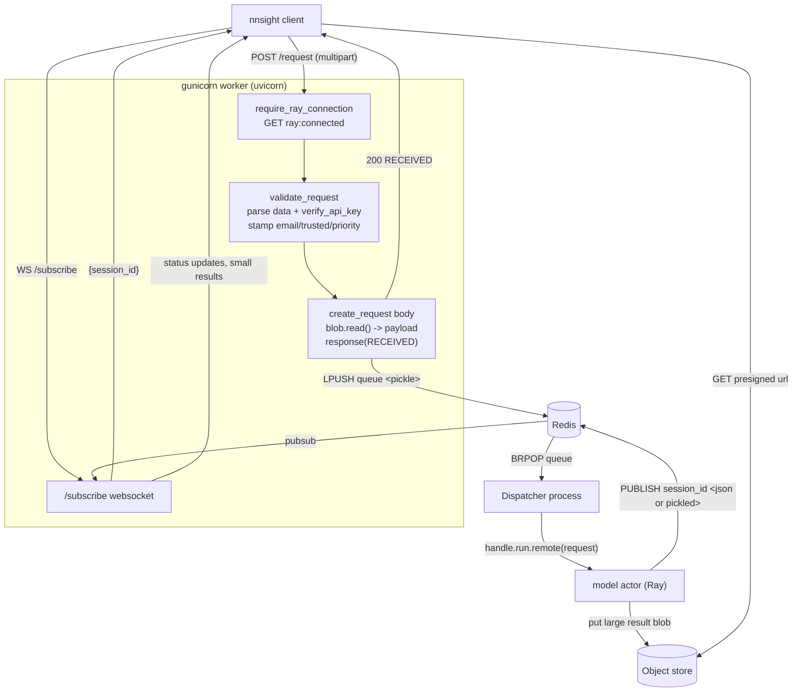

# API Service

## What this covers

`src/ndif/services/api/` — the only part of NDIF a client talks to: one FastAPI
module (`app.py`), an auth layer, a version gate, and a gunicorn config. How it
boots, what runs per worker vs. per process, how a POST becomes a queue entry,
and how the result gets back out.

Three constraints shape the whole design:

1. **The API process cannot talk to Ray.** Only the dispatcher holds a Ray
   client connection. Everything the API needs from the cluster (status, env,
   dispatch) goes through Redis, which is why `/status` and `/env` are
   cache-and-wake-up dances rather than RPCs.
2. **The API forwards results but never produces them.** The model actor
   publishes a small result on the COMPLETED response and the `/subscribe`
   forwarder passes it to the client; a large one, or any non-blocking result,
   goes to the object store as a presigned URL. The cap is
   [Status and Results](../concepts/status-and-results.md)'s topic.
3. **Ingress is where trust is decided.** The `trusted` flag stamped here
   determines whether a caller's Python runs inside the model actor process or in
   a separate runner, and whether it may deploy a model key asking for
   `trust_remote_code` — see
   [The `trusted` flag](#the-trusted-flag--read-this-before-you-deploy).

## Boot

`src/ndif/services/api/start.sh` is the entrypoint (registered as the `api`
service in `src/ndif/cli/service.py` `SERVICES`, so `ndif start api` runs it).
It exports `NDIF_SERVICE=api` for log labelling and `exec gunicorn --config
python:ndif.services.api.gunicorn_conf ndif.services.api.app:app`.

`src/ndif/services/api/gunicorn_conf.py` sets `bind` from `NDIF_API_PORT`
(8001), `workers` from `NDIF_API_WORKERS` (1), `timeout` from
`NDIF_API_TIMEOUT` (120), and `worker_class = "uvicorn.workers.UvicornWorker"`.
Two hooks do the interesting work:

- **`on_starting`** starts the queue dispatcher as a **spawned** (not forked)
  process, exactly once, in the gunicorn master. Its target `_run_dispatcher`
  imports the Influx and Loki providers and then `Dispatcher.start()`.
- **`post_fork`** imports `ndif.common.providers.influx` and
  `ndif.common.providers.loki` *in each worker*.

Both exist because the telemetry providers must connect after the fork; the
reasoning, and why `preload_app = True` breaks it, is in
[Telemetry Internals](telemetry-internals.md).

> **Gotcha:** the dispatcher lives in the *master's* child, not in a worker. Set
> `NDIF_API_WORKERS=4` and you get four web workers and still exactly one
> dispatcher — which is what you want, since the dispatcher holds all per-model
> queue state in process memory. See [Queue Internals](queue-internals.md).

## App-level middleware and handlers

`src/ndif/services/api/app.py` registers exactly three things at the app level:
`CORSMiddleware` (`allow_origins=["*"]`, `allow_credentials=False` — auth is the
`ndif-api-key` header, not a cookie, and browsers reject a wildcard origin with
credentials), and two exception handlers, `log_http_exception` (a structured
`event()`, ERROR at 5xx and INFO at 4xx, then `{"detail": ...}`) and
`log_unhandled_exception` (an ERROR event with traceback, then a generic 500).
The handlers are the only place ingress failures become observable: a rejected
key or an unreachable backend raises before any endpoint body runs.

## The dependency chain

**`require_ray_connection`** (`src/ndif/services/api/app.py`) — an app-level
route dependency, not a middleware. It reads the `ray:connected` Redis flag
(written by `src/ndif/services/api/queue/dispatcher.py` `Dispatcher.connect`) and
raises 503 if absent. Applied to `/request`, `/status`, `/env`, and `/connected`.

**`validate_request`** (`src/ndif/services/api/auth.py`) — the `/request` body
dependency. It parses the multipart `data` form field into a
`BackendRequestModel` (422 on a bad envelope), copies the `ndif-api-key` header
onto `request.api_key`, calls `verify_api_key`, and stamps `email` / `trusted` /
`priority` from the resolved `Identity` so they travel with the request through
the queue.

**`verify_api_key`** (`src/ndif/services/api/auth.py`) is the policy layer over
`PostgresProvider`. Auth is entirely optional: if `NDIF_POSTGRES_URL` is unset,
`PostgresProvider.enabled()` is False and the function returns `None`.

With Postgres configured, a key is valid **iff its row exists in `keys`** — key
issuance is a separate login/account service's job. `_KEY_QUERY` LEFT JOINs
`key_user_tag_assignments` / `user_tags`, so a key with no tags still returns one
row (tag NULL), distinguishing "known key, no tags" from "unknown key".

| Failure | Status |
|---|---|
| No key sent | 401 |
| Key present but not a UUID | 400 |
| Well-formed key not in `keys` | 403 |
| Postgres unreachable / errored | 503 (fail closed) |

### The `trusted` flag — read this before you deploy

`validate_request` stamps four things onto the request from the resolved
`Identity`: `email`, `trusted` (`Identity.trusted` — the key carries the
`TRUSTED_TAG` user_tag), `trust_remote_code` (`Identity.trust_remote_code` — the
`TRUST_REMOTE_CODE_TAG` user_tag, or `trusted`, which implies it) and `priority`
(`Identity.priority`, the `PRIORITY_TAG`).

```python
client_set_trusted = "trusted" in request.model_fields_set
identity = await verify_api_key(request.api_key)
if identity is not None:
    request.email = identity.email
    request.trusted = identity.trusted        # overwrites any client value
    request.trust_remote_code = identity.trust_remote_code
    request.priority = identity.priority
else:
    if not client_set_trusted:
        # Auth is off (NDIF_POSTGRES_URL unset), a trusted-network / dev mode.
        # Default to trusted only when the client didn't ask; an explicit
        # trusted=True/False from the client stands.
        request.trusted = True
    request.trust_remote_code = request.trust_remote_code or request.trusted
```

`trust_remote_code` is the narrower grant: it lets the key deploy a model whose
key asks for the checkpoint's own code, and says nothing about where the
request's own code runs.

`BackendRequestModel.trusted` defaults to `False`
(`src/ndif/common/schema/request.py`), and that default is what makes user code
run in a separate process. With auth **on**, the key's `trusted` user_tag decides
and any client-supplied value is overwritten. With auth **off**, the client's
own `trusted` is honored — `model_fields_set` distinguishes "unspecified" (which
defaults to `True`) from an explicit `trusted=False`, so a dev can opt into the
sandbox path by sending `trusted: false` without standing up Postgres.

**What `trusted` decides on the GPU side:**

- A **trusted** request's traced block is executed **in-process inside the model
  actor, next to the loaded weights** — `SandboxModelDeployment.execute` defers
  to the base implementation when `request.trusted`
  (`src/ndif/services/ray/sandbox/model.py`).
- An **untrusted** request's block is shipped to a separate runner subprocess and
  driven over a Unix socket, so arbitrary user Python never runs in the actor
  process. This is process separation, not a security boundary — see
  [Sandbox Execution](../concepts/sandbox-execution.md).
- `trusted` also decides whether a model key asking for `trust_remote_code` may
  be deployed, via the path below.

> **Gotcha:** "no Postgres configured" does not only mean "no auth". It means
> **a caller's arbitrary Python runs in-process next to the weights by default, and
> any model key asking for `trust_remote_code` is deployed as asked** — a client can drop to the
> sandbox path with `trusted: false`, but nothing forces it to. If your API is
> reachable by anyone you don't trust, set `NDIF_POSTGRES_URL` and issue keys.
> `priority` is left as the client sent it when auth is off (only the auth-on
> branch stamps it), defaulting to False.

### `trusted` through the queue and into the model load

This section is the reference for how a deployment's `trusted` is fixed, and
with it whether a key asking for `trust_remote_code` can be deployed; other pages
link here.

The flag is not re-derived anywhere. `request.trust_remote_code` (true for the
`trusted` *or* the `trust_remote_code` tag) rides the pickled request into the
queue, where `Processor.enqueue` passes it to `Processor.ensure_started`, which
stores it on the processor (`src/ndif/services/api/queue/processor.py`).
`Replica.provision` then asks the controller for one more replica with
`DeploymentConfig(trusted=processor.trust_remote_code)` — the config's `trusted`
is that permission, not the sandbox choice —
(`src/ndif/services/api/queue/replica.py`); `Cluster.deploy`
(`src/ndif/services/ray/deployments/controller/cluster/cluster.py`) first checks
it against the key (`untrusted_remote_code`: a key carrying `trust_remote_code`
from an untrusted config is refused before the checkpoint is read), then passes
it to the node, which stamps it onto the `Deployment`. The actor's load is told
nothing: nnsight's `from_model_key` reads `trust_remote_code` off the key itself.

`ensure_started` only assigns when its argument is not `None`, and a
*re*-provision after an eviction passes `None`. So: **whichever request first
causes a model to be deployed fixes that deployment's `trusted` for its
lifetime.** A request carrying either tag deploys a key asking for
`trust_remote_code`, and every later untagged request runs against that same
deployment (and can scale it: `_ControllerActor._like_existing` inherits the
running replica's trust). Evicting and redeploying is the only way to change it.

**`validate_client_versions`** (`src/ndif/services/api/versioning.py`) is called
inside the `/request` body, not as a dependency. It compares the client's
`nnsight-version` / `python-version` headers against `MIN_NNSIGHT_VERSION` /
`MIN_PYTHON_VERSION`, read from `NDIF_MIN_NNSIGHT_VERSION` /
`NDIF_MIN_PYTHON_VERSION` once at import. An unset minimum skips that check
entirely; otherwise a missing, malformed, or too-old version is a 400. Only
major.minor of the python version is compared.

## The request path



### POST /request in detail

Every line of `create_request` (`src/ndif/services/api/app.py`) matters:

- `request.payload = await blob.read()` pulls the *entire*
  serialized-interventions blob into memory. No streaming, no size cap.
- The `ndif-timestamp` header (the client's send time) becomes a `SENT` bucket on
  `RequestStatusTimeMetric` — client→server transit — but only when
  `received_at >= sent_at`, so obvious clock skew is dropped.
- `request.response(Status.RECEIVED, ...)` advances the status *without
  publishing anything*. `BackendRequestModel._advance_status`
  (`src/ndif/common/schema/request.py`) seeds `last_status_time`, which doubles
  as the ingress timestamp and travels with the pickled request so the next hop
  (QUEUED) can bill the gap.
- `async_bytes_client.lpush(QUEUE_CONFIG.queue_key, pickle.dumps(request))` is
  the entire handoff. `LPUSH` plus the dispatcher's `BRPOP` gives FIFO. The
  binary client is required — `async_client` has `decode_responses=True` and
  would mangle the pickle.
- `RequestSizeMetric` gets the payload size plus the caller's IP (read only here)
  and user-agent.

The `BackendResponseModel` returned over HTTP is the *only* status the client
gets synchronously; everything after is pubsub or object store.

## Responses out

`BackendRequestModel.respond` / `arespond` (`src/ndif/common/schema/request.py`)
is the single fan-out point: Redis pub/sub on the `session_id` channel for a
blocking job, the object store at `responses/{request_id}.json` (read back by
`GET /response/{id}`) for a non-blocking one. The mechanics are in
[The Redis Layer](redis-layer.md#response-publishing).

Nothing in the API writes a response itself except the RECEIVED one it returns.
QUEUED / PROVISIONING / DEPLOYING come from the Processor, DISPATCHED from the
Replica, RUNNING / LOG / COMPLETED / ERROR from the model actor
(`src/ndif/services/ray/deployments/modeling/base.py`
`BaseModelDeployment.run`).

### The websocket

`subscribe` (`src/ndif/services/api/app.py`) accepts, mints
`session_id = uuid.uuid4().hex`, subscribes to the Redis channel of that name on
the bytes client, and *only then* sends `{"session_id": ...}`. Subscribing before
handing out the id closes a lost-message race: the client only POSTs after
receiving the id, so the channel is live before any status can be published.
A message starting with `{` is forwarded as a text frame; anything else is a
pickled response carrying the result and goes as a binary frame.

Then two tasks race: `forward()` pumps `pubsub.listen()` to the socket, and
`watch_disconnect()` sits in `websocket.receive()` (the client never sends, so it
returns only on disconnect). `asyncio.wait(..., FIRST_COMPLETED)` tears down
whichever loses; the `finally` cancels both and
`gather(..., return_exceptions=True)`s them, because `CancelledError` is a
`BaseException` that a plain `except Exception` would let bubble out as a logged
"Exception in ASGI application".

## `/status` and `/env`

Both go through `_coalesced_fetch` (`src/ndif/services/api/app.py`): a Redis
cache the dispatcher refreshes on demand, with one refresh per miss no matter how
many callers. The handshake, TTLs and failure codes are in
[The Redis Layer](redis-layer.md#the-coalesced-cache).

## Where per-worker state lives

There is almost none, which is why multiple workers are safe. Per worker: the
version minimums read at import, the Redis client singletons, the boto3 clients
and `_bucket_ready`, the Postgres pool, the Loki and Influx shipper threads
created in `post_fork`, and any live websocket sessions. Queue / Processor /
Replica state is **not** here at all — it belongs to the dispatcher process.

A client's `/subscribe` socket and its `POST /request` can land on different
workers. That is fine: the only link between them is the `session_id` Redis
channel.

## Gotchas

> **Pickle on the wire.** `create_request` pickles a `BackendRequestModel` into a
> Redis list and `Dispatcher.get` (`src/ndif/services/api/queue/dispatcher.py`)
> unpickles it. Anyone who can write to the `queue` key gets code execution in
> the dispatcher process. Redis has no auth in the dev compose stack and its port
> is published to the host (compose service `redis`, `ports`).

> **`/response/{id}` takes no API key** (`get_response` in
> `src/ndif/services/api/app.py`). A request id is a uuid4 hex, but knowing one
> lets anyone read that job's latest response — including, on COMPLETED, the
> presigned result URL. `/whoami` also takes no required key: a missing or
> unknown key resolves to `{"email": null, "tags": []}`; with auth on, a malformed
> one returns 400.

> **`ray:connected` has no TTL.** If the dispatcher process dies outright, the
> flag stays set and `require_ray_connection` keeps passing — see
> [The Redis Layer](redis-layer.md#the-rayconnected-flag).

> **No request size limit.** `await blob.read()` buffers the whole payload, then
> pickles it into a Redis string. Redis's 512MB value ceiling is the effective
> limit; nothing in the API rejects an oversized blob earlier or more clearly. The
> size is measured (`RequestSizeMetric`) but never enforced.

> **Blocking calls must be wrapped.** `ObjectStoreProvider.get` is boto3
> (synchronous), so `/response/{id}` runs it through `asyncio.to_thread`, and
> `arespond` does the same for the object-store write. Metric emission is already
> non-blocking; S3 and the sync Redis client are not. Version gating is
> import-time — changing `NDIF_MIN_NNSIGHT_VERSION` needs a restart.

## Related

- [HTTP API](../reference/http-api.md) — the endpoint-by-endpoint reference.
- [Queue Internals](queue-internals.md) — what happens after the `LPUSH`.
- [Sandbox Execution](../concepts/sandbox-execution.md) — what `trusted` selects
  between.
- [Request Lifecycle](../concepts/request-lifecycle.md) — the same journey
  without the code.
- [Auth and Limits](../concepts/auth-and-limits.md) — the API-key model from the
  operator's side.
- [Schemas](../reference/schemas.md) — the `BackendRequestModel` fields.
- [The Redis Layer](redis-layer.md), [Redis Keys](../reference/redis-keys.md) —
  every key this service touches.
- [nnsight Integration](nnsight-integration.md) — the client half of the contract.
