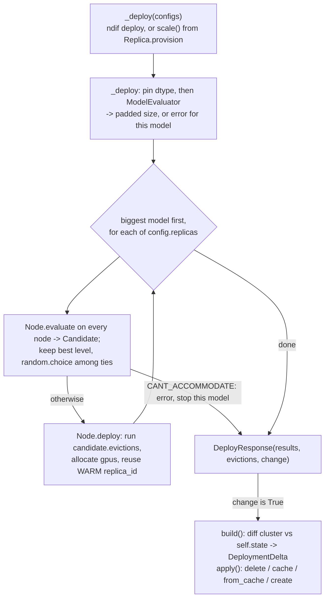

# Controller Internals

## What this covers

The single actor that decides which model runs on which GPU. It answers `deploy` / `evict` /
`get_deployment` for the API's queue and the `ndif` CLI, and turns its placement decisions into Ray
actor lifecycle operations. This page is the home of sizing, placement, the eviction policy and the
`build()`/`apply()` diff; [Deployments and Eviction](../concepts/deployments-and-eviction.md) is the
mental-model version. Three facts frame the design:

1. **The cluster model is entirely in memory and never persisted.** `Cluster` tracks per-GPU free
   bytes by decrementing its own numbers. Ray is consulted only for node *membership* (`list_nodes`)
   and the raw capacity each node advertised at boot — never for live GPU utilisation.
2. **There is no periodic reconcile of deployments.** The only background loop re-syncs the *node
   set*. Every deployment change is event-driven: a `deploy`/`evict` call mutates the cluster model,
   then `apply()` diffs it against the last-applied state and fires the Ray calls.
3. **Deploy is additive.** `DeploymentConfig.replicas` means "add this many new replicas", never
   "make the total this many" (`src/ndif/common/schema/controller.py` `DeploymentConfig`). Shrinking
   is `evict`'s job. `scale` is additive too — it differs only in where the unspecified fields come
   from: a live replica (`_ControllerActor._like_existing`) rather than the controller's defaults,
   so growing a tensor-parallel model gives you more tensor-parallel replicas.

## The actor

`ControllerActor` (`src/ndif/services/ray/deployments/controller/controller.py`) is `_ControllerActor` wrapped in
`@ray.remote(num_cpus=1, num_gpus=0, max_restarts=-1, resources={"head": 1})`.
`resources={"head": 1}` pins it to the head node — `resources.py` puts `head=10` only there
([Ray Service](ray-service.md)). `num_gpus=0` because it never touches a GPU itself.

`app()` resolves the controller class from `NDIF_CONTROLLER_IMPORT_PATH` (`_import_from_path`,
defaulting to this module's own `ControllerActor`) and launches it as `name="Controller"`,
`namespace="NDIF"`, `lifetime="detached"`, `get_if_exists=True`. `detached` keeps it alive after the
one-shot launching driver `start.sh` runs exits. Because `_ControllerActor.deploy` and
`.check_nodes` are `async def`, Ray makes this an asyncio actor; the synchronous methods (`evict`,
`status`, `build`, `apply`) share that event-loop thread and never interleave.

> **Gotcha:** `get_if_exists=True` makes relaunching idempotent, but a relaunch against a live
> cluster **silently reuses the old actor and discards the new arguments**. Changing
> `NDIF_MINIMUM_DEPLOYMENT_TIME_SECONDS` and re-running the launcher does nothing until that actor
> is gone.

## Object model

**`Cluster`/`Node` decide, `_ControllerActor` executes.** Nothing under `cluster/` calls Ray except
`Deployment`; nothing in `controller.py` computes memory.

| Class | Defined in | Responsibility |
|---|---|---|
| `_ControllerActor` | `src/ndif/services/ray/deployments/controller/controller.py` | The RPC surface. Owns `self.state` (last-applied replicas) and drives Ray actor lifecycle via `build()`/`apply()`. Makes **no** placement decisions. |
| `Cluster` | `src/ndif/services/ray/deployments/controller/cluster/cluster.py` | The node set. Syncs nodes from Ray, ranks candidate nodes for a placement, fans an evict across nodes. Owns the `ModelEvaluator`. |
| `Node` | `src/ndif/services/ray/deployments/controller/cluster/node.py` | One GPU node: `GPUResources`, `CPUResources`, its HOT `deployments` and its WARM `cache`. All memory arithmetic and eviction *selection* lives here. |
| `Deployment` | `src/ndif/services/ray/deployments/controller/cluster/deployment.py` | One replica. Placement bookkeeping (gpus, size, pinned, `deployed` timestamp) **plus** the Ray ops `create`/`delete`/`cache`/`from_cache`. |
| `ModelEvaluator` | `src/ndif/services/ray/deployments/controller/cluster/evaluator.py` | Estimates a model's padded byte footprint and how far it shards, memoized per `model_key`. |
| `Candidate` | `src/ndif/services/ray/deployments/controller/cluster/node.py` | A node's answer to "can you take this model": a `CandidateLevel`, the GPU allocation it would use, the evictions required, and optionally a stated `reason` for refusing. |

## DeploymentLevel

| Level | Where it lives | Meaning |
|---|---|---|
| `HOT` | `node.deployments[model_key][replica_id]` | Weights on GPU, actor serving requests. Holds a GPU-memory allocation. The only level `get_deployment` returns. |
| `WARM` | `node.cache[model_key][replica_id]` | Same actor process, weights offloaded to CPU RAM (`BaseModelDeployment.to_cache` in `src/ndif/services/ray/deployments/modeling/base.py`). Holds a CPU allocation, no GPU. Dispatching to it raises `CachedActorError`. |
| `COLD` | nowhere | Never attached to a `Deployment`. `status()` synthesizes COLD entries from `get_downloaded_models()` for repos in the HF cache but not deployed. |

## Sizing a model

Placement needs bytes, so `ModelEvaluator.__call__` asks nnsight to describe the checkpoint —
`Remotable.describe_checkpoint`, one call returning its size, parameter count, config and revision,
read from the Hub's published parameter count and falling back to building the architecture on the
meta device for a repo that publishes none — then pads:
`ceil(base + base * padding_factor + padding_bias)`. `DeploymentConfig.size_bytes` replaces the
estimate outright, which also makes it the one placement input needing no network.

Both terms exist because overhead has two shapes. The **bias** (default 500 MiB) covers the
roughly-constant per-actor cost — CUDA context, workspace, allocator floor — which a pure percentage
badly underestimates for a small model. The **factor** (default 0.15) covers activation and
workspace memory that scales with model size, which a pure constant underestimates for a large one.
Both are overridable per deploy (`DeploymentConfig.padding_factor` / `.padding_bias`) and have
controller-wide defaults (`NDIF_DEFAULT_PADDING_FACTOR` / `NDIF_DEFAULT_PADDING_BIAS`).

The estimate is cached by `model_key` and recomputed when the request's `dtype` differs from the
cached entry (`ModelEvaluator._entry`) — element sizes change the number. `trust_remote_code` is in
the key, so keys differing in it are separate entries. This is why `_ControllerActor._deploy`
pins `config.dtype` to `NDIF_DEFAULT_DTYPE` before evaluating: the estimate and the actor's actual
load must use the same dtype, or the accounting is wrong from the start. `_ControllerActor.deploy`
first warms this cache off the event loop (`_describe`), since sizing reaches the Hub. An evaluator
failure (bad repo id, gated model, a key without the `trust_remote_code` its checkpoint needs) is *returned*, not raised — `Cluster.deploy` turns
it into `ModelDeployResult.error` with the full traceback. `ModelEvaluator.__init__` also calls
`torch.set_default_dtype(torch.bfloat16)`, a process-global side effect.

## `trust_remote_code`

The controller sizes and loads a model with whatever the key's `trust_remote_code` field says;
`DeploymentConfig` has no such field, and `status()` reports it per HOT and WARM deployment via
`src/ndif/common/types.py` `key_field`. The key field and how it is minted are in
[Models and Deployment](../operating/models-and-deployment.md#trust_remote_code-in-the-model-key);
who may deploy such a key is decided at the API
([Auth and Limits](../concepts/auth-and-limits.md#trust_remote_code)). The controller does not check.

`load_model_config` (`src/ndif/cli/lib/model_config.py`) passes every `DeploymentConfig` field
through, so a `dtype:`, `padding_factor:` or `execution_timeout_seconds:` line in `models.yaml`
takes effect; `ndif deploy --dtype` likewise overrides `NDIF_DEFAULT_DTYPE` for that deploy.

The per-*request* `trusted` flag decides whether user code runs in a separate runner
process — process separation, not a security boundary; see
[Sandbox Internals](sandbox-internals.md).

## Placing a replica

`Node.evaluate` grades one node. It computes `gpus_needed = ceil(size / per_gpu_memory)` — or takes
`DeploymentConfig.gpus` if given — and more than the node has is an immediate `CANT_ACCOMMODATE`. A
model that will be tensor-parallel has its count rounded **up** to a degree it actually shards into,
because an uneven split does not run at all; an explicit `gpus` that the model cannot shard into is
refused with a stated reason. Each card is then charged `ceil(size / gpus_needed)`: its share, not
all of it. `GPUResources.fitting` returns the GPUs with room sorted by *least* free memory first:
best-fit, so small models pack into partly-used cards rather than fragmenting empty ones.

| `CandidateLevel` | Value | Meaning |
|---|---|---|
| `DEPLOYED` | 0 | Never returned by `Node.evaluate`. |
| `CACHED_AND_FREE` | 1 | A WARM copy is here **and** there is GPU room without evicting. |
| `FREE` | 2 | GPU room without evicting. |
| `CACHED_AND_FULL` | 3 | WARM copy here, but evictions are needed. |
| `FULL` | 4 | Evictions are needed. |
| `CANT_ACCOMMODATE` | 5 | Impossible on this node even with every legal eviction. |

Lower is better. `Cluster.deploy` (`src/ndif/services/ray/deployments/controller/cluster/cluster.py`) places the biggest models first, keeps
only the best-level candidates and breaks ties with `random.choice` — cheap spreading across
identical nodes. Preferring a node that already holds the model WARM is what makes a WARM→HOT
promotion (a CPU→GPU copy) beat a cold disk load.

## Choosing and executing evictions

**GPU** — `Node.find_evictions`. For each GPU it needs, it lists the *evictable* occupants, sorts
them smallest-allocation-first, and takes them until the shortfall is covered. Per-GPU plans are
then sorted by how many evictions they cost, and the cheapest `gpus_needed` plans win. If any needed
GPU can't be freed it returns `([], {})` and the node grades `CANT_ACCOMMODATE`. Each
`(model_key, replica_id)` is an independent occupant — evicting one replica of a model does not pull
its sibling on the same card.

`Node.evictable` (`src/ndif/services/ray/deployments/controller/cluster/node.py`) is the whole policy:

```python
def evictable(self, deployment: Deployment, pinned: bool) -> bool:
    if deployment.pinned:
        return False
    if (
        not pinned
        and self.minimum_deployment_time_seconds is not None
        and time.time() - deployment.deployed < self.minimum_deployment_time_seconds
    ):
        return False
    return True
```

A pinned deployment is never auto-evicted, and one younger than
`NDIF_MINIMUM_DEPLOYMENT_TIME_SECONDS` (default 3600) is protected *unless the incoming model is
itself pinned* — the `pinned` argument describes the request, not the victim. The age rule stops
thrashing: without it, two models that each need most of a GPU would evict each other on
alternating requests and neither would ever serve. `Cluster.deploy` also passes
`exclude=all_model_keys`, the models in *this* request, so a batch deploy can't evict its own
members for each other.

**CPU** — `Node.find_cache_evictions` frees WARM-cache room by dropping cached deployments
smallest-first, returning `None` if it can't free enough — the signal that a HOT→WARM demotion isn't
possible. `Node.evict` then executes one eviction: a **WARM** replica is dropped and its CPU bytes
released; a **HOT** replica releases its GPU bytes and, if `find_cache_evictions` can supply CPU
room, is **demoted to WARM** with the *same* `replica_id` and a fresh `Deployment` — otherwise it is
removed outright. A replica whose actor class sets `CACHEABLE = False` (the tensor-parallel actors)
is always removed outright (`Deployment.cacheable`). Preserving `replica_id` matters because the
actor's Ray name is `f"{replica_id}:ModelActor:{model_key}"` (`Deployment.name`), so the same
process survives the transition and a later promotion reuses it (`Node.deploy`).

> **Gotcha:** `Node.evict` does **not** consult `evictable`. Pinning and the minimum-deployment-time
> rule only gate *automatic* eviction during placement. An explicit `ndif evict gpt2` always
> succeeds, pinned or not.

## The deploy cycle



Separately, `_ControllerActor.check_nodes` loops forever calling `Cluster.update_nodes()` every
`NDIF_CONTROLLER_SYNC_INTERVAL_S` seconds (default 30): it adds newly-joined GPU nodes and, for a
node that is no longer `ALIVE` in Ray, pops it and calls `Node.purge()`, killing every actor on it.
A sync that raises, as Ray's state API does when a node doesn't answer, is logged and retried on the
next tick. It never calls `apply()`, refreshes an existing node's capacity, or checks the model actors
themselves.

## build() and apply()

`_ControllerActor.build` diffs the live cluster model against `self.state`, keyed by
`(node_id, model_key, replica_id)`, into a `DeploymentDelta` with four lists:
`deployments_to_cache` (was HOT in state, now in `node.cache`), `deployments_from_cache` (was WARM,
now in `node.deployments`), `deployments_to_create` (`(node_name, deployment)` pairs with no state
entry) and `deployments_to_delete` (in state, gone from the cluster model).
`_ControllerActor.apply` executes them in order:

1. **delete** — `ray.kill(actor, no_restart=True)`.
2. **cache** (HOT→WARM) — `actor.to_cache.remote()`, then **blocks** on every future with `ray.get`.
   The one synchronous step, because step 3 assumes that GPU memory is already free.
3. **from_cache** (WARM→HOT) — `actor.from_cache.remote(self.gpus)`.
4. **create** — builds `BaseModelDeploymentArgs` (model key, execution timeout, dtype), calls `Deployment.create(name, args)` which injects `gpu_mem_bytes_by_id =
   self.gpus`, then awaits `actor.__ray_ready__`.

Steps 3 and 4 are awaited off the main path by `_ControllerActor._monitor_deployment` — awaiting the
`ObjectRef` directly is legal in an async actor and non-blocking, so a multi-minute load doesn't
stall the controller. On failure it kills the actor and calls
`_ControllerActor._remove_deployment_from_state`, dropping the entry from `self.state` *and*
releasing the node's GPU/CPU bytes — the only thing keeping a failed load from leaking accounted
memory.

## The RPC surface

| Method | Called by | Argument | Returns |
|---|---|---|---|
| `deploy` (async) | nothing in this repo — `_describe` + `_deploy`, for a caller that wants the checkpoints described first | `str` / `list` / `{model_key: DeploymentConfig}` | `DeployResponse` |
| `_deploy` | `ndif deploy` and the dashboard, both through `src/ndif/cli/lib/deploy.py` `deploy` | same | `DeployResponse` |
| `scale` | `Replica.provision` and `ndif scale` (`src/ndif/cli/lib/scale.py`) | `model_key`, `n`, optional `DeploymentConfig` | `DeployResponse` |
| `evict` | `ndif evict`, `deploy --sync` | `model_key`, optional `replica_id` | `ReplicaStates` (pre-eviction snapshots) |
| `get_deployment` | `Processor.start`, `Processor.reconcile`, `ndif restart` | `model_key`, optional `replica_id` | `ReplicaStates` (HOT only) |
| `status` | dispatcher, dashboard, `ndif status` | — | `{"deployments": {...}, "cluster": {...}}` |
| `get_state` | `ndif status --verbose` | `include_ray_state` | raw cluster + evaluator + config dump |
| `env` | dispatcher's `env_worker` | — | `{"python_version", "packages"}` for client version gating |

Schemas live in `src/ndif/common/schema/controller.py` because both sides speak them
([Schemas](../reference/schemas.md)); `ModelDeployResult` guarantees exactly one of `replicas` /
`error` is meaningful. `_ControllerActor.status` starts from Ray's `list_actors()`, asked for up to
2,000 entries because the list holds a `DEAD` record for every actor Ray has run and a live replica
past the limit would be missing from `status`. It collapses
duplicate records for an actor name to the healthiest state (`RUNNING` < `DEPLOYING` < `UNHEALTHY`),
then enriches each entry the controller tracks with its level, `pinned`, `trust_remote_code` (read
off the key), `dtype`,
`execution_timeout_seconds`, `repo_id`, `task`, `revision`, `n_params`, `size_bytes`, `actor_class`
and `gpus` count — so an actor Ray knows about but the controller doesn't ends up with **only**
`application_state` set.

Un-enriched `UNHEALTHY` entries are then dropped: Ray retains a `DEAD` record for every actor it has
ever run, so every evict and restart leaves one behind, and consumers of `deployments` expect a
`repo_id`. A dead actor the controller *does* still track survives the filter, because that
combination is a genuine signal: the controller believes a replica is deployed while its actor is
gone.

## Environment

The controller's variables are read in `ControllerDeploymentArgs` (`src/ndif/services/ray/deployments/controller/controller.py`) at module import in the
launching driver — the ray container's environment — and passed to the actor as constructor
arguments. `NDIF_CONTROLLER_SYNC_INTERVAL_S` is the exception: read inside the actor each loop.

The variables, defaults and fallbacks are in
[Env vars — Controller and model defaults](../reference/env-vars.md#controller-and-model-defaults).

## Failure modes

**Deploy rejected.** When every node grades `CANT_ACCOMMODATE`, `ModelDeployResult.error` carries
the first reason a node stated (for example an explicit `gpus` count the model cannot shard into);
otherwise it reads `"CANT_ACCOMMODATE: placed N of M new replicas before the cluster ran out of
room."` — the padded size exceeds every GPU on every node, or the only occupants big enough to free
are pinned or too young. Raising `NDIF_MODEL_CACHE_PERCENTAGE` won't help; that budget is CPU
cache. Evict something explicitly, lower `NDIF_MINIMUM_DEPLOYMENT_TIME_SECONDS`, deploy `--pinned`
(which waives the age check), or lower `padding_factor` for that model. `ndif status` shows each
GPU's `available_memory_bytes` as the controller believes it — the number the rejection was
computed against. **"No GPU nodes available."** is different: `Cluster.nodes` is empty because
`update_nodes` skips every Ray node without a `GPU` resource, so check the ray container's GPU
passthrough. See [Model OOM on Deploy](../runbooks/model-oom-on-deploy.md).

**Deploy fails during evaluation.** The error carries the evaluator's full traceback: usually a
gated or nonexistent repo, or a model needing `trust_remote_code` deployed under a key without it
(see [`trust_remote_code`](#trust_remote_code)).

**Evict finds nothing.** `Cluster.evict` returns an empty `ReplicaStates` and the CLI prints `✗
<key>: nothing to evict` (`src/ndif/cli/lib/evict.py`). Usually a model-key mismatch — the key
derives from checkpoint *and* revision *and* task *and* envoy class (`src/ndif/cli/lib/models.py`
`get_model_key`), so `ndif evict gpt2` won't match a deployment made with a non-default
`--revision` or `--task`. Evict is never *refused* for policy.

**State after a controller restart.** `max_restarts=-1` means Ray restarts a crashed controller, and
`__init__` starts from a **blank** `Cluster` and empty `self.state` while the detached model actors
survive — still holding GPU memory the rebuilt model believes is free. Symptoms: `ndif status` shows
deployments with only `application_state`, and the next deploy over-commits a GPU into a CUDA OOM.
Recovery: kill the orphaned actors directly (`ndif evict` won't find them) and let the controller
re-place.

**A model actor that dies after a successful deploy.** `_monitor_deployment` awaits only the
initial load and `check_nodes` checks nodes, not actors, so the `Deployment` record and its GPU
reservation outlive a permanently dead actor; `get_deployment` keeps returning that replica id to
the queue. `ndif evict` of the model clears the record.

**A node blip kills its deployments.** If a node disappears from the `ALIVE` node list even briefly,
the next `check_nodes` pass pops it and `purge()`s every actor on it — no grace period. Relatedly,
`status()` skips enrichment for any deployment whose `model_key` is missing from
`evaluator.cache`, so entries render bare.

## Related

- [Ray Service](ray-service.md) — the node, resources and ports underneath.
- [Model Actor](model-actor.md) — `to_cache` / `from_cache` / the request loop on the other end of
  every `apply()` call; [Sandbox Internals](sandbox-internals.md) for per-request `trusted`.
- [Queue Internals](queue-internals.md) — `Replica.provision`, the busiest caller.
- [Deployments and Eviction](../concepts/deployments-and-eviction.md) — the mental-model version;
  [Schemas](../reference/schemas.md) and [Env Vars](../reference/env-vars.md) — the lookup tables.
