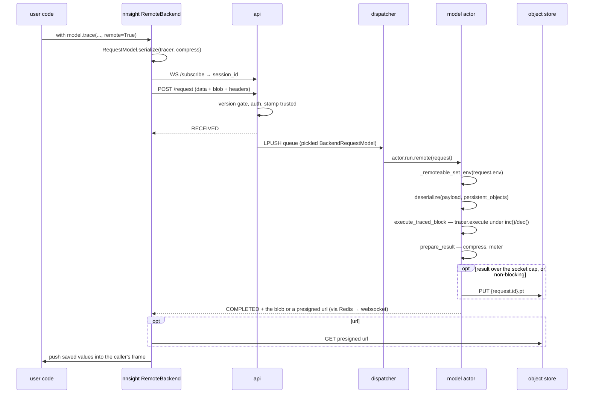

# nnsight Integration

## What this covers

nnsight is not a library NDIF happens to import — it is the protocol. This page is
the contract: what a remote trace puts on the wire, how the server rebuilds and
runs it, which nnsight internals the server reaches into (and so must not break),
what client/server version drift does, and how to run the server against a local
nnsight. nnsight's own docs ([nnsight.net](https://nnsight.net)) are the reference
for the tracer, the interleaver and `.save()`.

Two facts frame the design:

1. **The model never travels; the code does.** A request names a model by
   `model_key` and carries the traced block. Everything that would otherwise be
   serialized — the model, its modules, its tokenizer, the interleaver — is written
   as a **persistent id** and resolved on the server against live objects.
2. **The block ships as source text, not bytecode.** nnsight reduces a traced `with`
   block to `(source, referenced globals, referenced locals)` and the server
   recompiles it. Source is not tied to a CPython version, which is why a 3.11
   client can drive a 3.12 server.

The server pins nnsight in both `pyproject.toml` and
`requirements.txt`. The specifier names the pre-release explicitly because pip only
considers pre-releases when the specifier does; a bare `nnsight` resolves to 0.7.

## The wire

A remote run is one multipart `POST /request` plus, for a blocking run, one
`/subscribe` websocket opened *first* so no status update is missed. All of it is
read in `src/ndif/services/api/app.py` `create_request`:

| Part | Content | Read by |
|---|---|---|
| form field `data` | `RequestModel.metadata()` — the JSON envelope: `model_key`, `session_id`, `compress`, `env` | `validate_request` parses it into a `BackendRequestModel` |
| file field `blob` | the serialized payload | `request.payload = await blob.read()` |
| header `ndif-api-key` | the caller's key | `verify_api_key` |
| header `nnsight-version` | the client's nnsight version | `src/ndif/services/api/versioning.py` `validate_client_versions` |
| header `python-version` | the client's full `sys.version` | same |
| header `ndif-timestamp` | client send time, for the `SENT` latency bucket | `create_request` |

`compress` is bidirectional — the payload is zstd-compressed *and* the result
should come back compressed. `env` is a per-request dict the client's model wrapper
produced, applied server-side before the run (PEFT adapters).



## Serialization and deserialization

Client side, `RequestModel.serialize(tracer, compress)` reduces the block with
nnsight's `reduce_block` (source padded with blank lines so remote tracebacks point
at real line numbers, and the enclosing scope filtered to the names the source
references), cloudpickles `(tracer, interventions)` — writing any object that
carries `_persistent_id` as that id (`"Interleaver"`, `"Module:<path>"`, and the
wrapper's own, such as a tokenizer) — and optionally zstd-compresses. The payload is
the tracer graph, the block's source and scope, and *holes* where the model would
be.

Server side, `src/ndif/services/ray/deployments/modeling/nns.py`
`prepare_traced_block` fills the holes:

```python
persistent_objects = model._remoteable_persistent_objects()
tracer = deserialize(payload, persistent_objects, compress=compress)
```

The actor passes `BackendRequestModel.deserialize`, which wraps nnsight's static
`RequestModel.deserialize` and classifies failures into caller-facing errors. The
sandbox runner calls the same function with its own unpickler (`IPCCloudUnpickler`)
and a map built from a meta model — see
[Sandbox internals](sandbox-internals.md#persistent-ids-and-the-meta-model).

Inside, nnsight decompresses, unpickles, recompiles the source under the original
filename, restores the captured scope onto the tracer's frame, and **registers the
source in `linecache`** so a traceback can show the user's line. That write is why
every request runs inside `block_scope()` (same module), entered in
`BaseModelDeployment.run` and by the runner's `run`: it snapshots and restores
`linecache.cache` and nnsight's `SOURCES` and `BLOCKS` memo tables, which are keyed
by `(filename, line)` and never re-validated. Without the restore, a later request
reusing the same trace-site coordinates would run the *previous* request's compiled
block.

## Running the block and collecting the saves

Both paths (and every tensor-parallel rank) run the block through `execute_traced_block`
in `src/ndif/services/ray/deployments/modeling/nns.py`:

```python
seed_block(seed)
with request_dtype(dtype):
    inc()
    try:
        tracer.execute(tracer.info.code)
        saves = _saves()
        saved = {
            name: value
            for name, value in tracer.info.frame.f_locals.items()
            if id(value) in saves
        }
    finally:
        dec()
```

- `request_dtype` is the autocast region (half precision on CUDA only, with
  `cache_enabled=False` so a block that trains sees updated weights). The sandbox
  host enters the same region around the forward it drives.
- `inc()`/`dec()` bracket a trace scope the way the client's `Tracer.__exit__` does,
  so `nnsight.save()` records into this thread's save set. `_saves()` is a set of
  **object ids**; intersecting it with the frame's locals returns each saved value
  under the name it was bound to, and drops a saved object with no name. That is
  why `.save()` is the only channel out of a remote trace, and why users save a
  container and append into it.

The dict is written with `torch.save(..., pickle_module=cpu_pickle_module())`
(`src/ndif/services/ray/deployments/modeling/util.py` `cpu_pickle_module`), a
cloned `pickle` whose `Pickler` relocates non-CPU tensors to CPU before
serializing. The runner uses the same helper, so the host uploads the runner's bytes
verbatim.

## What NDIF imports from nnsight

Every one of these is an internal a nnsight refactor can break. `grep -rn "from
nnsight" src/ndif` bounds the blast radius of a client bump.

| Symbol (under `nnsight.`) | Imported by | What breaks if it changes |
|---|---|---|
| `schema.request.RequestModel` | `common/schema/request.py`, `ray/tp/shard.py` | the envelope and both directions of (de)serialization |
| `schema.response.ResponseModel`, `Status` | `common/schema/response.py`, the actors | the status wire format |
| `intervention.serialization.UnknownPersistentIdError`, `CustomCloudUnpickler` | `common/schema/request.py`; `ray/sandbox/nns.py` | deserialize error classification; the runner's id resolution |
| `modeling.huggingface.HuggingFaceModel`, `CheckpointUnreachable` | `ray/deployments/modeling/base.py`, `ray/tp/`; the evaluator | model loading (`from_model_key(..., device_map, max_memory, dispatch, torch_dtype)`) |
| `modeling.mixins.remotable.Remotable`, `bytes_per_element` | the evaluator, `ray/sandbox/nns.py`, the dashboard monitor | meta-device sizing and model-key round-tripping |
| `tracing.globals.BLOCKS`, `SOURCES` | `ray/deployments/modeling/nns.py` | the per-request snapshot/restore |
| `tracing.tracer._saves`, `inc`, `dec` | `ray/deployments/modeling/nns.py` | collecting saved values at all |
| `tracing.util.clean_traceback`, `filter_traceback` | `ray/deployments/modeling/base.py`, `ray/sandbox/nns.py` | the user-facing traceback in an `ERROR` |
| `intervention.interleaver.{Interleaver, Mediator, Event, EarlyStopException, OutOfOrderError, Pending}` | `ray/sandbox/nns.py`, `ray/sandbox/driver.py` | **the split interleaver** — below |
| `intervention.barrier.Barrier` | `ray/sandbox/nns.py` | host-counted barriers |
| `intervention.envoy.Envoy` | `ray/sandbox/nns.py` | the whole-class patch that routes model calls over IPC |
| `intervention.source.SourceEnvoy`, `install_source`, `SourceNotAvailable` (and `instrument`, `make_op`, `bind`) | `ray/sandbox/nns.py`, `ray/sandbox/driver.py` | `.source` inside a sandboxed trace |
| `intervention.batching.Batcher` | `ray/sandbox/driver.py` | host-side input assembly |
| `intervention.cache.Cache` | `ray/sandbox/nns.py`, `ray/sandbox/driver.py` | `tracer.cache()` over the socket |
| `intervention.tracer.InterleavingTracer` | `ray/sandbox/nns.py` | the `cache` patch |
| `modeling.quantization.quantization` | `ray/deployments/modeling/util.py` | quantized loading |
| `util.from_import_path`, `util.apply` | `cli/lib/models.py`, `ray/sandbox/driver.py` | model-key resolution, nested-structure mapping |

Paths are relative to `src/ndif/services/` except `common/` and `cli/`, which are
under `src/ndif/`.

### The interleaver contract is the deepest coupling

The sandbox **cuts nnsight's own `Mediator` in half**: `MediatorProxy` subclasses
`Mediator` and reuses `handle` unchanged, and the runner patches `Mediator.event`
and `Barrier.__call__` to park over the socket. So it depends on `Mediator`'s
*internal* structure — the `(event, location, pin)` park tuple, the `Event` enum,
`handle`'s loop, `Interleaver.instrument`, `check_dangling_mediators`, `Barrier`'s
release contract — not just its public surface. A change there breaks the
untrusted path while the trusted path keeps working, and a bare `just up` never
exercises the untrusted path.

## What NDIF re-exports

Two subclasses that change nothing on the wire. `BackendResponseModel` adds nothing
to nnsight's `ResponseModel`, and `Status` is re-exported verbatim.
`BackendRequestModel` adds server-only fields (`id`, `api_key`, `email`,
`trusted`, `priority`, `payload`, the timing fields — full list in
[Schemas](../reference/schemas.md)) plus `respond`/`arespond`.

So **a new status or response field is an nnsight change, not an NDIF change**: a
client whose `Status` lacks a member fails pydantic validation, which surfaces as a
broken remote run. To convey something new without a client release, put it in
`description` on an existing status, or emit a `LOG` — skipped by
`src/ndif/common/schema/request.py` `BackendRequestModel._advance_status` and
printed by clients.

## The seams nnsight provides for NDIF

Prefer these over reaching further in.

| Seam | NDIF's use |
|---|---|
| `deserialize(..., unpickler=)`, constructed as `unpickler(file, persistent_objects)` | the runner passes `IPCCloudUnpickler`, which resolves unknown ids to `None` instead of raising |
| `_remoteable_persistent_objects()` → `{persistent_id: live object}` | the in-process actor passes it to `deserialize`; the runner builds the same map from a meta model |
| `_remoteable_get_env()` / `_remoteable_set_env(env)` | PEFT adapter swap, applied off the event loop inside `run`'s `try` so a bad adapter id becomes a normal `ERROR`; the runner applies it again to its meta model |
| `to_model_key()` / `from_model_key(key, **kwargs)` | deployment identity everywhere — queue keys, actor names, `models.yaml` |
| `Remotable.describe_checkpoint(...)` / `Remotable.max_tp_size(...)` | the controller's size estimate and shardability, from checkpoint metadata before any weights load (`src/ndif/services/ray/deployments/controller/cluster/evaluator.py`) |
| `_saves()` / `inc()` / `dec()` | collecting the values to return |
| `cloudpickle.register_pickle_by_value` (via `nnsight.register`) | ships a local module's source so user code can use modules the server lacks |

## When client and server versions differ

The block's *source* is version-independent; what it closes over is not. Tensors,
tokenizers, config objects and every nnsight internal in the payload cross as
ordinary (cloud)pickles.

| Drift | Effect |
|---|---|
| Client Python 3.11, server 3.12 | fine — the source reparses; the design goal |
| Client syntax the server's Python can't parse | `SyntaxError` at deserialize, an `ERROR` |
| A referenced third-party object whose pickle format changed | an unpickling error at deserialize |
| A locally-defined helper the server has never seen | `ModuleNotFoundError`, unless registered |
| Client and server nnsight differ | unsafe — below |

When the nnsight versions disagree, roughly in order of how often it bites:

- **A changed class layout.** The tracer is pickled; if `Tracer`/`Interleaver`/
  `Envoy` gained or lost attributes the payload unpickles into an object the server
  misuses — often an `AttributeError` deep in nnsight, reported as the user's job
  failing.
- **A changed persistent-id scheme.** Ids the server's map lacks fail at
  deserialize.
- **A different module tree for the same checkpoint.** A client `transformers` that
  builds a different tree fails with the architecture-mismatch sentence, or parks on
  a location the forward never reaches.
- **Semantic drift with no error.** A default that changed between transformers
  releases produces different numbers, not an exception.

The API's version gate (`NDIF_MIN_NNSIGHT_VERSION` and the Python check) rejects
the worst cases at ingress — operator side in
[Configuration](../operating/configuration.md#the-client-version-gate).
`nnsight.compare()` diffs the client against the server's `GET /env`, a TTL'd cache
of the controller's environment (`NDIF_ENV_TTL_S`, default 300 s), so it can lag a
redeploy by that long. The text of each error is in
[Error messages](../reference/error-messages.md).

**Client-side packages.** The client builds the model wrapper on the meta device to
resolve module paths, so it needs enough of the ecosystem to build the *same
architecture* the server loaded. A PEFT request (`TransformersModel(repo,
peft="<adapter repo id>")`) needs `peft` on the client too, or its meta model has
no adapter modules and the user's paths don't match; the server fetches the adapter
from the Hub by id, so a local adapter directory is invisible to it. Any optional
package that changes a module tree is the same. Local helper modules that aren't
pip-installed are registered by `pull_env()` before the first remote request, or
explicitly with `nnsight.register(module)`.

## Developing against a local nnsight

This is the one home for the procedure; other pages link here.

**On the compose stack**, `docker/docker-compose.nnsight.yml` bind-mounts a
checkout over the image's nnsight in `api`, `ray` and `dashboard`, so client
changes are picked up without a rebuild:

```bash
export NNSIGHT_PATH=/path/to/nnsight/src/nnsight   # the package dir, not the repo root
just nnsight                                        # prints what would be mounted
just up
```

- **`NNSIGHT_PATH` names the package directory** (`<checkout>/src/nnsight`), and
  every `just` invocation must carry it: a `just up` or `just ta` without it
  recreates the containers without the mount.
- **Auto-detection** (no `NNSIGHT_PATH`) needs a host `python` that imports an
  *editable* nnsight; with no such `python` it is skipped silently and the image's
  pinned copy is used. A non-editable nnsight under `site-packages` is
  deliberately not mounted.
- **Build the compiled extension in the checkout.** A fresh checkout has no
  `nnsight._c` extension, and under the mount every remote `.save()` then fails
  with an `AttributeError`. Build it in place with the image's toolchain:

  ```bash
  docker run --rm --entrypoint python -v <checkout>:/src -w /src dev-ray setup.py build_ext --inplace
  ```

- **Verify the mount** with `grep nnsight /proc/self/mountinfo` inside the
  container, or by importing a symbol only your branch has.
  `nnsight.__version__` reports the image's installed version even under the
  mount, so it cannot tell you.

**Outside Docker**, install nnsight first:

```bash
pip install -e /path/to/nnsight        # before installing ndif
pip install -e ".[api,ray,metrics,postgres,dashboard]"
```

Order matters: the `ndif` install resolves its `nnsight` requirement against what is
already present, so installing nnsight afterwards can pull a PyPI release over your
checkout. The published wheels ship the compiled `nnsight._c.py_mount` extension;
an **sdist** install needs a compiler, and without one setuptools silently skips
the extension and `.save()` inside a *remote* block raises `AttributeError` — the
mount is a server-side dependency. The image keeps `gcc` and `libc6-dev` for that
fallback (`docker/Dockerfile`).

To build the image against an unreleased nnsight, replace the `nnsight` line in
`requirements.txt` with a git ref (`git+https://github.com/ndif-team/nnsight.git@<ref>`);
the image carries `git` for that. For iterating on the payload format with no
server, nnsight's `remote="local"` serializes and deserializes a trace exactly as
the remote path does and runs it in-process — evidence the serialization half is
intact, and nothing about the queue, actor or sandbox.

## Bumping the client

1. **Does a request still deserialize?** Any change to the tracer's pickled layout
   or the persistent-id scheme fails here, before any model work.
2. **Does `Status` still have every member the server emits?** Grep `Status.` under
   `src/ndif/`.
3. **Do `_saves()`, `inc()`, `dec()` keep their semantics?** They are
   underscore-private and carry no stability promise.
4. **Does the sandbox still interleave?** Send `trusted=False` (a bare `just up`
   otherwise runs everything trusted) and run a read, a swap, a multi-invoke batch,
   a `tracer.iter` loop and a barrier; compare against the same request trusted.
5. **Do model keys still round-trip?** A change to `to_model_key`'s format orphans
   every `models.yaml` entry and every `NDIF_DEPLOYMENTS` key.
6. **Raise `NDIF_MIN_NNSIGHT_VERSION`** to the oldest client that still works, and
   restart the API.

`pytest tests/` against a running stack is the test story — see
[Testing](testing.md).

## Server behaviors that are really nnsight behaviors

When triaging a user report, these are upstream: `.save()` is the only way values
leave a remote trace; an external list `.append`ed inside a remote trace comes back
empty (the appends hit the server's copy); `remote=True` belongs on
`model.session(...)`, since a session is one request; `print()` arrives as `LOG`
updates, one per complete line (`src/ndif/services/ray/deployments/modeling/util.py`
`LogStream`); a `ModuleNotFoundError` naming the user's own module means an
unregistered local module; and a traceback that stops at the user's frames is
deliberate (`BaseModelDeployment.format_error`).

## Related

[Configuration](../operating/configuration.md#the-client-version-gate) for the
operator's side of the version gate; [Sandbox internals](sandbox-internals.md) for
the split interleaver; [Model actor](model-actor.md) for the `run` template;
[Schemas](../reference/schemas.md) and [HTTP API](../reference/http-api.md) for the
fields and endpoints; [External resources](../reference/external-resources.md) for
nnsight's own docs.
