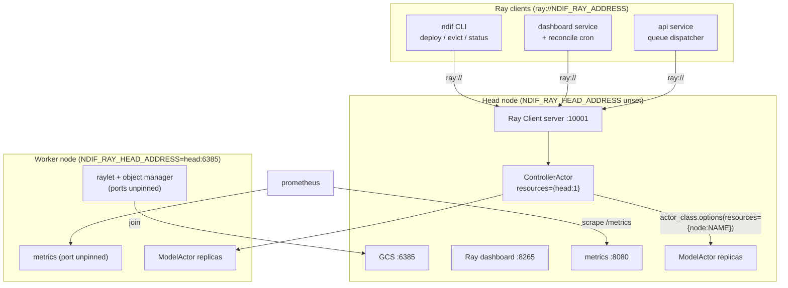

# Ray Service

## What this covers

The `ray` service is the compute half of NDIF: a Ray node (head or worker), the
custom resources it advertises, and — on the head only — the NDIF controller
that places model actors on it. This is the infrastructure view; what the
controller does with the cluster is [Controller Internals](controller-internals.md),
and what a model actor does once placed is [Model Actor](model-actor.md). Model
deployments are plain detached Ray actors, not Ray Serve — see
[Architecture Overview](architecture-overview.md).

**Head vs worker is one env var, and nothing else.**
`src/ndif/services/ray/start.sh` branches on `NDIF_RAY_HEAD_ADDRESS` alone.
Every other `ray start` flag is env-driven with a default.

## Head or worker

`NDIF_RAY_HEAD_ADDRESS` unset means "be the head". Set (to the head's
`HOST:PORT`) means "join that head as a worker":

```bash
if [ -z "$HEAD_ADDRESS" ]; then
    # ---- Head node ----
    unset RAY_ADDRESS
    resources=$(python -m ndif.services.ray.resources --head)
    ray start --head --resources="$resources" ...
    RAY_ADDRESS="127.0.0.1:${NDIF_RAY_HEAD_PORT:-6385}" \
        python -m ndif.services.ray.deployments.controller.controller
else
    # ---- Worker node ----
    HEAD_ADDRESS="${HEAD_ADDRESS#ray://}"
    wait_for_head "$HEAD_ADDRESS"
    ray start --address="$HEAD_ADDRESS" --resources="$resources" \
        --temp-dir="$NDIF_RAY_TEMP_DIR"
fi
```

Three things to note:

- **`NDIF_RAY_HEAD_ADDRESS` is not `NDIF_RAY_ADDRESS`.** The latter is the
  `ray://` *client* address the API, dashboard and CLI dial in on; it says
  nothing about head/worker. Confusing the two is the most common way to end up
  with two disconnected single-node clusters.
- The head runs `unset RAY_ADDRESS` first so Ray's own env var can't make
  `ray start --head` try to attach to an existing cluster.
- A worker blocks on `wait_for_head`, polling `/dev/tcp` until the head's GCS
  port accepts a connection — `NDIF_RAY_HEAD_WAIT_RETRIES` (60) attempts,
  `NDIF_RAY_HEAD_WAIT_INTERVAL_S` (2) seconds apart, then exit 1 — so a worker
  container can start before the head.

Only the head launches the controller. `python -m ...controller.controller`
runs as a short-lived *driver*: it `ray.init(address="auto", namespace="NDIF")`
against the head just started, which `start.sh` names in `RAY_ADDRESS` for that
one command, then calls `app()` to schedule the detached actor (`get_if_exists=True`, so a relaunch
reuses a live one), then exits.

`start.sh` runs `ray start --block` in the background, waits for the head's
GCS port, launches the controller, then waits on `ray start`. With `--block`,
Ray supervises this node's daemons itself: it checks them every second, and
when one exits with an unexpected code (a crash, an OOM kill, SIGKILL) it kills
the rest of this node and exits 1, which takes the container, or the `ndif
start --foreground` that runs it, down rather than leaving it looking healthy.
A daemon that exits on SIGTERM counts as a graceful exit and goes unreported.
On SIGTERM or SIGINT `start.sh` passes SIGTERM to `ray start`, which stops this
node's daemons only (not other Ray clusters on the host), and exits 0.

**The controller names its own cluster to Ray.** Given no address, Ray's
`ray.init(address="auto")`, its state API (`list_nodes`, `list_actors`) and its
bootstrap lookup guess: `RAY_ADDRESS`, then `ray_current_cluster` under the
*default* temp dir (not `--temp-dir`'s), then any running GCS process visible on
the host, and the state API raises if it sees more than one. A compose `ray`
container has its own process namespace and only ever sees one GCS; a
from-source `ndif start` on a host shared with another Ray cluster does not. So
the launcher gets `RAY_ADDRESS`, and the controller passes
`ray.get_runtime_context().gcs_address`, its own cluster, to `list_nodes`,
`list_actors` and `Cluster.state`.

## Ports

Every flag below is on the **head** branch. The worker branch passes only
`--address`, `--resources` and `--temp-dir`.

| Port | `ray start` flag | Env var | Default | What it is |
|---|---|---|---|---|
| 6385 | `--port` | `NDIF_RAY_HEAD_PORT` | `6385` (start.sh and CLI) | GCS. What workers join and `wait_for_head` probes. |
| 8076 | `--object-manager-port` | `NDIF_RAY_OBJECT_MANAGER_PORT` | `8076` | Plasma object transfer between nodes. |
| 8265 | `--dashboard-port` | `NDIF_RAY_DASHBOARD_PORT` | `8265` | Ray's own web dashboard, bound `0.0.0.0`. |
| 52366 | `--dashboard-agent-grpc-port` | `NDIF_RAY_DASHBOARD_GRPC_PORT` | `52366` | Per-node dashboard agent gRPC. |
| 8080 | `--metrics-export-port` | `NDIF_RAY_METRICS_PORT` | `8080` | Prometheus scrape endpoint (`/metrics`). |
| 10001 | — (Ray's default) | — | `10001` | Ray Client server: the `ray://` endpoint. |

8265 and 10001 are Ray's own defaults. Ray's GCS default is `6379`, which
collides with Redis, so NDIF uses `6385`: both the CLI
(`src/ndif/cli/config.py` `NDIF_RAY_HEAD_PORT`) and `start.sh`'s own fallback
default to it. Whatever a worker's `NDIF_RAY_HEAD_ADDRESS` says must match the
head's actual `NDIF_RAY_HEAD_PORT`. `--object-manager-port`,
`--dashboard-agent-grpc-port` and `--metrics-export-port` default to a random
free port in Ray, so the head pins them, which is what makes a firewall rule or a
static Prometheus target possible.

> **Gotcha:** a *worker* pins none of them. Its object manager, dashboard agent
> and metrics port are each whatever free port Ray picks that boot, so a second
> node needs an open ephemeral range rather than three firewall holes, and its
> `/metrics` cannot be a static Prometheus target — use the `file_sd_configs`
> discovery file below.

The compose file publishes only 8265 and 10001 to the host (compose service
`ray`, `ports`); everything else stays on the compose network.

## Custom resources

`src/ndif/services/ray/resources.py` is shelled out to by `start.sh` and prints
a JSON blob straight into `ray start --resources`:

```python
if head:
    resources["head"] = 10

resources["cuda_memory_bytes"] = get_total_cuda_memory_bytes()
resources["cpu_memory_bytes"] = get_total_cpu_memory_bytes()
```

| Resource | Computed from | Consumed by |
|---|---|---|
| `cuda_memory_bytes` | `sum(torch.cuda.mem_get_info(d)[1])` over all devices | `Cluster.update_nodes` — divided by the node's `GPU` count to get per-GPU capacity |
| `cpu_memory_bytes` | `psutil.virtual_memory().total` | `Cluster.update_nodes` — scaled by `NDIF_MODEL_CACHE_PERCENTAGE` (default 0.9) into the node's WARM-cache budget |
| `head=10` | present on the head only | `@ray.remote(..., resources={"head": 1})` on `ControllerActor` — this is what pins the controller to the head |

(`src/ndif/services/ray/deployments/controller/cluster/cluster.py`
`Cluster.update_nodes`; `src/ndif/services/ray/deployments/controller/controller.py`
`ControllerActor`.)

These are two **separate budgets**: `cuda_memory_bytes` funds the GPU-resident
(HOT) model, `cpu_memory_bytes` funds the CPU-resident WARM cache.
`NDIF_MODEL_CACHE_PERCENTAGE` scales only the second.

Both numbers are *totals*, not what's free at boot, so the advertised budget does
not depend on what happened to be running when the node started. Ray never
enforces either one — the controller reads them back and decrements them in its
own in-memory model. The chosen allocation is injected as the actor's
`gpu_mem_bytes_by_id` argument by `Deployment.create`
(`src/ndif/services/ray/deployments/controller/cluster/deployment.py`), which the actor turns into a device placement and
per-process memory caps — that is what actually confines it.

Model actors are pinned to a node with Ray's implicit per-node resource rather
than a custom one, in `Deployment.create`:

```python
actor_class.options(
    name=self.name,
    resources={f"node:{node_name}": 0.01},
    namespace="NDIF",
    lifetime="detached",
    runtime_env={"env_vars": env_vars},
).remote(**deployment_args.model_dump())
```

The actors also set `RAY_EXPERIMENTAL_NOSET_CUDA_VISIBLE_DEVICES=1` so Ray does
*not* mask GPUs — the controller assigns specific GPU indices and the actor
honours them itself.

> **Gotcha:** `Cluster.update_nodes` lists only `ALIVE` nodes and skips any node
> without a `GPU` resource. A CPU-only Ray head registers zero managed nodes and
> every deploy fails with `"No GPU nodes available."` — including a laptop
> `ndif start` with no NVIDIA GPU.

> **Gotcha:** per-GPU capacity is `cuda_memory_bytes // GPU_count`, so a node
> with mixed GPU models (say a 24 GB card and an 80 GB card) is modelled as two
> identical 52 GB cards. Keep GPUs homogeneous per node.

## Node topology



## How clients connect

Everything outside the Ray cluster goes through `ray://`, wrapped by
`RayProvider` (`src/ndif/common/providers/ray.py`), whose `CONFIG` reads
`NDIF_RAY_ADDRESS` (default `ray://localhost:10001`).

Each `ray.init` against `ray://` makes the proxier on the head fork a per-client
server process. `start.sh` exports `GRPC_ENABLE_FORK_SUPPORT=0` (unless the
operator set it) before `ray start`: with grpc's fork support on, that child can
die silently at birth and the client waits 40 s for `Starting Ray client server
failed`. The proxier inherits the variable, so it must be set in the head node's
environment, not the client's.

`RayProvider.connect` verifies the host/port is listening before calling
`ray.init`, and `RayProvider.connected` is deliberately stricter than "the
cluster is up" — it also requires that `ray.get_actor("Controller",
namespace="NDIF")` resolves. The dispatcher's connect loop therefore won't
proceed until the control plane is actually serving.

Actor handles come back as `NDIFActorHandle`
(`src/ndif/common/providers/ray.py`), a `ClientActorHandle` subclass whose
`__getattr__` returns a minimal remote-method stub. Stock Ray Client fetches
every method's signature over RPC on first attribute access and unpickles the
annotations client-side, which drags `BackendRequestModel` and its transitive
imports into the caller's process. NDIF callers pass hardcoded method names with
known shapes, so the descriptor prefetch and `signature.bind` are skipped.
`handle.method.remote(...)` works unchanged.

Named actors, both in namespace `NDIF`:

| Name | Created by | Looked up with |
|---|---|---|
| `Controller` | `app()` in `src/ndif/services/ray/deployments/controller/controller.py` | `get_controller_actor_handle()` |
| `{replica_id}:ModelActor:{model_key}` | `Deployment.create` | `get_model_actor_handle(model_key, replica_id)` |

## Metrics

Ray's per-node metrics agent serves Prometheus text on the
`--metrics-export-port`. The dev stack scrapes it statically
(`docker/prometheus/prometheus.yml`, job `ray`, target `ray:8080`). Ray is the
only NDIF service that speaks Prometheus; everything else pushes to InfluxDB and
Loki ([Telemetry Internals](telemetry-internals.md)). For a multi-node cluster,
swap `static_configs` for `file_sd_configs` pointing at
`<NDIF_RAY_TEMP_DIR>/prom_metrics_service_discovery.json`, which Ray rewrites as
nodes join and leave.

## Logging

`start.sh` exports `NDIF_SERVICE=ray` *before* `ray start`, so the raylet and
every actor process it later spawns inherit it and their Loki lines are labelled
`service=ray`. Model actors override it to `model` in their `runtime_env`
(`Deployment.create`) so their telemetry attributes separately. Provider
configuration (Redis, object store, Loki, Influx) is likewise pushed into each
actor's `runtime_env` by `_provider_runtime_env()`
(`src/ndif/services/ray/deployments/controller/cluster/deployment.py`) — a Ray
worker inherits only its node's ambient environment, so anything the launcher
configured must be forwarded explicitly.

## Container requirements

The compose-level needs — the GPU reservation, `shm_size`, and an explicit
`NDIF_REDIS_URL` on the `ray` service — are in
[Compose Stack](../operating/compose-stack.md). Two more apply however the node
is launched:

- **A writable `NDIF_RAY_TEMP_DIR`** (default `/tmp/ray`). `start.sh` exits with
  a clear error rather than letting `ray start` fail obscurely.
- **A visible GPU.** Without one, `torch.cuda.device_count()` is 0,
  `cuda_memory_bytes` is 0, and the node is invisible to the controller.

Ray itself is an optional extra: `pip install ".[ray]"` pulls `ray[default]`
plus `transformers`, `accelerate`, `numpy`, `zstandard` and `peft`
(`pyproject.toml`, `ray` extra); the exact Ray pin is in the repo-root
`requirements.txt`. `src/ndif/services/ray/requirements.txt` is empty.

## Running a worker

```bash
# On the worker host, with the head's GCS reachable:
NDIF_RAY_HEAD_ADDRESS=head.internal:6385 \
ndif start ray
```

`ndif start` with `NDIF_RAY_HEAD_ADDRESS` set defaults its target list to just
the ray service (`src/ndif/cli/commands/start.py` `start`) — a worker host does
not need Redis, RustFS or the API. The worker's GPUs appear in the controller
within `NDIF_CONTROLLER_SYNC_INTERVAL_S` (30s), when its node-sync pass next
runs.

## Related

- [Controller Internals](controller-internals.md) — what the controller does
  with the nodes and resources this page sets up.
- [Model Actor](model-actor.md) — the actors the controller places here.
- [Providers](providers.md) — `RayProvider` alongside the other providers.
- [Services and Topology](../concepts/services-and-topology.md) — where Ray sits
  in the whole stack.
- [Compose Stack](../operating/compose-stack.md), [Ports](../reference/ports.md)
  — the operator views.
- [Add a GPU Node](../runbooks/add-a-gpu-node.md) — the worker-join recipe end
  to end.
