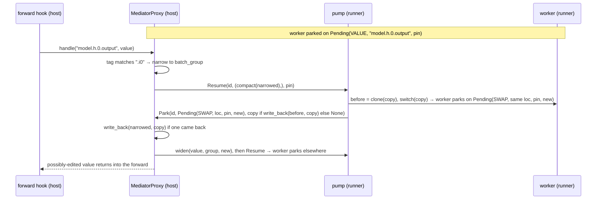

# Sandbox Internals

## What this covers

`src/ndif/services/ray/sandbox/` — the modules that run a request's traced block
(arbitrary user Python) in a separate runner process while the model it
interleaves with stays on the actor's GPUs. **It is process separation, not a
security boundary** — see [What the separation is](#what-the-separation-is).

Two facts frame the design: **the model never moves** (weights load in the actor
and stay there — `src/ndif/services/ray/deployments/modeling/base.py`
`BaseModelDeployment.load_from_disk`), and **the block and the forward pass are
interleaved**, taking strict turns — locally a greenlet switch, here a process
boundary that must not change the semantics.

The modules, by layer:

| Layer | Module | Holds |
|---|---|---|
| wire | `protocol.py` | frames, one codec, `Channel`, `Fanout` |
| messages | `messages.py` | one class per message and per control request |
| link | `link.py` | `Link`: receive by type, one exchange |
| host | `driver.py` | the request loop, the run loop, one `MediatorProxy` per worker |
| host | `controls.py` | the handler for each control request |
| runner | `worker.py` | `IPCInterleaver`, the worker's side of the loop |
| runner | `adapters.py` | replacements for nnsight's methods, and `install` |
| runner | `meta.py` | the weightless model and the unpickler |
| runner | `execute.py` | running one request |

`driver.py` knows nothing of Ray or requests, so a tensor-parallel shard can be a
host too (`src/ndif/services/ray/tp/`). `model.py`, `host.py` and `runner.py` run
the sandbox itself: `src/ndif/services/ray/sandbox/model.py` is the **actor**
side (the runner pool, the request lifecycle, and error reporting, most of it in
the `SandboxHost` mixin the sharded actor shares), `host.py` spawns runners, and
`runner.py` is the runner process.

This page assumes nnsight's interleaver (`Mediator`, `Event`, park/switch,
occurrence tagging). `src/ndif/services/ray/sandbox/ARCHITECTURE.md` is
authoritative for the *why*, and `src/ndif/services/ray/sandbox/messages.py` for
what each message carries; this page adds the request-level context and the
lifecycle.

## The first branch: trusted vs untrusted

`BackendRequestModel.trusted` (`src/ndif/common/schema/request.py`; `"trusted"
in request.tags`) decides whether the sandbox runs at all:

| `request.trusted` | Path | Where the block runs |
|---|---|---|
| `True` | `SandboxModelDeployment.execute` defers to `BaseModelDeployment.execute` | in the model actor process, next to the weights — no runner, no socket |
| `False` | `execute` calls `SandboxHost.run_in_runner` | in a separate runner process |

`SandboxHost.execution_scope` forks the same way: trusted reuses the base's
stdout/stderr capture, untrusted gets a `nullcontext` because its output arrives as
`Print` messages. How the tags are stamped (the key's user_tags plus its user's
with auth on; client-supplied tags honored and unspecified ones defaulting to `{"trusted"}`
with auth off) lives in [Auth and limits](../concepts/auth-and-limits.md).

> **Gotcha:** a plain local `just up` has no Postgres, so a request is trusted by
> default and the sandbox path doesn't run. Send `tags: []` in the request to
> force it — no Postgres needed. The design intent is that both paths produce the
> same results for the same request, which is why the sandbox reuses nnsight's own
> `Mediator.handle`, `Batcher` and `Cache` rather than reimplementing them;
> [What the untrusted path cannot do](#what-the-untrusted-path-cannot-do) lists
> where it does not.

## Which actor runs it

The sandbox exists only where `SandboxModelActor` is the deployed class. The
controller's built-in default is the in-process `ModelActor`; the compose stack sets
`NDIF_DEFAULT_MODEL_ACTOR_CLASS=ndif.services.ray.sandbox.model.SandboxModelActor`,
and the tensor-parallel equivalent is
`NDIF_TP_MODEL_ACTOR_CLASS=ndif.services.ray.tp.model.SandboxedTPModelActor`. The
full selection order is in
[Adding a model actor](adding-a-model-actor.md#selecting-your-actor).

## Transport

`src/ndif/services/ray/sandbox/protocol.py` (stdlib + torch only; both processes
import it): length-prefixed frames (`send_frame`/`recv_frame`; `recvn` raises
`ConnectionError` on a half-read, which is what a killed runner looks like), and a
one-byte-tagged codec (`encode`: raw `bytes`, UTF-8 `str`, or `torch.save`).
`torch` because `torch.load` takes a `map_location`, so the receiver places tensors
as they are rebuilt — `SandboxDriver.pump` sets it from `landing`. Both directions
use the same codec, and both ends use `Channel` as it is: a message is one object.

`src/ndif/services/ray/sandbox/link.py` `Link` sits on a channel and receives by
type. The caller names the messages it is waiting for (`receive`, or `request` to
send first). A message that can arrive at any point is handed to its handler in
`always` wherever that end is waiting. Anything else raises `ProtocolError`
naming what arrived and what was expected, so two ends that fall out of step fail
at that message.

## Message catalog

Each message is a class in `src/ndif/services/ray/sandbox/messages.py`, whose
docstrings say what the fields carry. This table maps each to the code on both
ends.

| Message | Dir | Sent by | Handled by |
|---|---|---|---|
| `Payload` | h→r | `SandboxHost.run_in_runner` | `Runner.handle` → `execute.run` |
| `Resume` | h→r | `MediatorProxy.switch` | `IPCInterleaver.pump` |
| `Reply` | h→r | `MediatorProxy.settle_control`, `release` | `IPCInterleaver.pump` |
| `Throw` (a `Dangling` kind) | h→r | `SandboxDriver.check_dangling` | `IPCInterleaver.throw` |
| `CacheHit` | h→r | `ShippingCache._record` | `IPCInterleaver.record`, wherever the runner is waiting |
| `Done` | h→r | `SandboxDriver.interleave` | ends `pump` |
| `Interleave` | r→h | `IPCEnvoy.interleave` | `SandboxDriver.interleave` |
| `Park` | r→h | `pump` | `MediatorProxy.resume` → `write_back`, `adopt` |
| `Stop` | r→h | `pump` on `tracer.stop()` | `MediatorProxy.resume` raises `EarlyStopException` |
| `Print` | r→h | `Writer.write` (runner.py) | the host link's `always` → `Status.LOG` |
| `End` | r→h | `execute.run` | `pump` returns the blob |
| `Failed` | r→h | `execute.run` | the host link's `always` raises `RunnerError` |

A `Park` carries where a worker waits next: nnsight's `Pending` for a model
location (`Event.VALUE`/`SWAP`/`SKIP`) or a barrier (`Event.BARRIER`), a control
request, or `None` when the worker has finished. A `Pending` crosses with the
worker's `tracer.iter` pin in its `iteration` field — the host owns the `.i{n}`
occurrence tag. A `Park` that answers a read also carries `edited`: the worker's
copy of the value if the block edited it in place, else `None`.

A control request asks the host for something only it can do. It is a subclass of
`Control`, it is answered by its handler in
`src/ndif/services/ray/sandbox/controls.py`, and the answer goes back in a
`Reply`:

| Request | Parked by | Handler |
|---|---|---|
| `Source` | `ipc_module_source`, `ipc_recursive_source` | `source` |
| `Call` | `IPCEnvoy.__call__` | `call` |
| `Observe` | `ipc_cache` | `observe`, which attaches a `ShippingCache` |

`MediatorProxy.settle_control` looks the request's type up in `HANDLERS` and
answers until the worker parks on a location, so `handle` never sees one. A new
kind of request is a class in `messages.py`, a handler registered with `@control`,
and the park in the runner.

## Lifecycle

### Spawn and the pool

`spawn` (`src/ndif/services/ray/sandbox/host.py`) picks `/tmp/sbx-<12 hex>.sock`,
builds the runner's environment from the `RUNNER_ENV` allowlist via `runner_env`,
prepends the repo root to `PYTHONPATH`, sets `PYTHONHASHSEED=0` and
`TOKENIZERS_PARALLELISM=false` (a tokenizers thread pool does not survive the
template's fork), launches
`ndif.services.ray.sandbox.runner` with the socket path, `peers`, its own pid,
the mode (`runner` or `template`) and — when the pool has one — the model key,
then polls until the socket accepts (`wait_for`, 30s), raising if the process
dies first. The runner's stderr is never discarded: it is the only report of a
request the runner could not finish.

A pool does not `spawn` its runners. Its first refill starts a `Template`: a
process launched by `spawn` in `template` mode, which does the start-up every
runner needs (imports, `adapters.install`, the meta model; ~4s) and then forks a
runner per `Template.fork`, ready in ~30ms. Forks share the template's memory:
~125 MB each against ~580 MB for a runner started from nothing (Llama-3.1-8B,
PSS). The template answers `fork <path>` and `kill <pid>` on its socket
(`runner.serve_template`); it is the runners' parent, so it is also what kills
them, and it reaps them only between commands, so a pid it is told to kill can
never be one the system has reused. A forked runner reseeds `random`, torch and
numpy (`runner.reseed`), or every runner would draw the template's numbers.

A child forked after its parent opened the GPU driver cannot use CUDA, so a
template whose meta-model build opened it (a model's own code can) exits, and
the pool falls back to `spawn` for every runner. A template that dies later is
replaced by the next refill.

`Pool` keeps up to `size` runners pre-warmed on background threads (`refill`) so a
request doesn't pay interpreter + nnsight import + meta-model build; `acquire`
takes a warm one (making one inline after 30s if none is ready) and tops the pool
back up. **There is no release-back-to-pool** — the caller owns the process and
must `stop()` it. `Sandbox.stop` SIGKILLs the runner and returns without waiting:
the exit takes ~150ms (the CUDA context's teardown) and the actor stops a
request's runner before it answers the request. `size` defaults to
`NDIF_SANDBOX_POOL_SIZE` (7, `src/ndif/services/ray/sandbox/model.py`
`DEFAULT_POOL_SIZE`).

A replica parked on the CPU (WARM) has no pool.
`SandboxModelDeployment.to_cache` closes it, which ends the waiting runners and
the template, and `from_cache` opens a new one before the weights move back, so
its runners start while they move. A closed pool raises from `acquire`.

The default was sized for runners started from nothing: refills run
concurrently, so a pool keeps up only if `size` is at least start-up / request
time (~6 then). With forks a smaller pool keeps up, unless CUDA is preloaded.

`NDIF_SANDBOX_PRELOAD_CUDA` makes each runner start CUDA before it binds its
socket (`runner.preload_cuda`), which takes ~0.45s off every request (A100) and
holds ~0.5 GB per waiting runner on the model's first card. The runner has to
be told which that is, because it sees every card the actor sees: the actor
passes it to the pool (`SandboxHost.open_pool`), and `host.spawn` hands it to
the runner, which makes it its current card. A model on several cards has CUDA
started on the first only; a value arriving from another card starts it there,
in the request. It is off by default for that memory. A runner that cannot
start CUDA early, because that card is full, reports it and serves anyway. With it on, the rate at which new
runners start CUDA limits throughput: 30 back-to-back small requests through a
pool of 7 ran at 2.5 per second, against 1.5 with it off, where each request
starts CUDA itself.

> **Gotcha:** a warm thread that fails to spawn is silent. `refill`'s `warm()` only
> decrements the counter in its `finally`; the exception dies with the thread and
> lands in the Ray worker's `.err` file, never the actor's log. The visible symptom
> is `acquire` waiting its full 30s and then spawning inline.

### The runner process

A runner process (`src/ndif/services/ray/sandbox/runner.py`) is started with
the socket path, `peers` and the model key. It calls `build` once, which calls
`adapters.install` (see [below](#persistent-ids-and-the-meta-model)) and then
`meta.load_meta_model(model_key)`, **before binding**, so a host that can
connect is a host whose runner is warm. A forked runner does not build: it
inherited both from its template.
A failed build is printed to
stderr and ignored: the map is an optimization, and without it ids resolve to
`None`. A runner's `__main__` first calls `die_with_parent`, a daemon thread that polls
`getppid` once a second and `os._exit(1)`s once it no longer matches the parent
pid `spawn` passed in — the actor was SIGKILLed (eviction, or an
unrecoverable-CUDA restart) and no Python cleanup ran. A forked runner watches
its template the same way. A template makes the same check between commands
in `serve_template` and starts no thread, so that it has one thread when it
forks. The pid is passed rather than read at start-up
because the imports come first: a parent that died during them had already been
replaced by init, which the runner then watched forever. It polls rather than
using `PR_SET_PDEATHSIG` because that signal fires when the parent *thread*
exits, and runners are spawned from short-lived threads.

`Runner.serve` accepts `peers` connections (dropping `spawn`'s readiness probe via
`_hung_up`), handles the exchange, and loops forever; a failing exchange goes to
stderr without killing the loop. `Runner.handle` takes the payload from the first
host to connect, redirects stdout *and* stderr to separate `Writer`s (one `Print`
per complete line; stderr because `warnings.warn` goes there), and calls
`execute.run`.

`src/ndif/services/ray/sandbox/execute.py` `run` applies the request's env
(`set_env`), deserializes with `BackendRequestModel.deserialize`, passing
`IPCCloudUnpickler` with the request's link bound, runs the block
through the in-process path's own `execute_traced_block` (same autocast bracket,
same save collection), and `torch.save`s the saved values with the shared
`src/ndif/services/ray/deployments/modeling/util.py` `cpu_pickle_module` — so the
host uploads the bytes as-is. Tracebacks don't survive serialization, so an
exception is **formatted here** (preferring the worker's `__intervention_tb__`)
and shipped as text with the terminal exception's class name.

### Persistent ids and the meta model

`IPCCloudUnpickler.persistent_load` (`src/ndif/services/ray/sandbox/meta.py`)
resolves the payload's persistent ids in three steps: `"Interleaver"` becomes an
`IPCInterleaver` bound to this request's link
(checked first, so the meta model's own interleaver can't shadow it); anything in
`PERSISTENT_OBJECTS` (`Module:<path>`, `Tokenizer`, `Pipeline`, …) resolves to the
runner's **meta** object, which lets a block call `model.tokenizer(...)` without a
round trip; anything else resolves to `None` rather than raising.

`load_meta_model` builds the map once per runner process, or once per template, from
`Remotable.from_model_key(...)._remoteable_persistent_objects()` — the map the
in-process actor builds from its real model, so the keys line up. `set_env`
rebuilds it per request from the payload's `env`, because an env can reshape the
tree (a PEFT adapter prefixes every path with `base_model.model`). Both are
best-effort: a diverged tree degrades to ids resolving to `None`, since every
activation is a socket round trip anyway — so `ArchitectureMismatchError` is raised
on the in-process path only.

`src/ndif/services/ray/sandbox/adapters.py` `install` applies process-wide
patches. Importing the module changes nothing; `runner.build` calls `install`,
and nothing on the host may: `Mediator.event` → `ipc_event` (park untagged);
`Barrier.__call__` → `ipc_barrier`; every callable on `IPCEnvoy` grafted onto
`Envoy` itself (the tracer's root is a model-wrapper subclass that *inherits*
`interleave`); `Envoy.source` → `ipc_module_source` and `SourceEnvoy.source` →
`ipc_recursive_source`; `InterleavingTracer.cache` → `ipc_cache`; and
`Tensor.backward`, `torch.autograd.backward` and `torch.autograd.grad` → a
`refusal()` each (no backward passes, see
[below](#what-the-untrusted-path-cannot-do)).

### The actor's seams

`SandboxModelDeployment` overrides only the seams of the `BaseModelDeployment.run`
template, so the timeout/cancel race, metrics, event logs and upload stay shared.
Each is on `SandboxHost` in `src/ndif/services/ray/sandbox/model.py` unless noted:

| Seam | Sandbox behavior |
|---|---|
| `execute` (`SandboxModelDeployment`) | trusted → base; else `run_in_runner(request, None)` |
| `execution_scope` | trusted → base capture; else `nullcontext` |
| `interrupt` (`SandboxModelDeployment`) | stop the runner, then the base `interrupt`, then wait for the execution thread to leave the model |
| `format_error` | `RunnerError` → its text verbatim, non-fatal; else base |
| `error_name` | `RunnerError` → its shipped `cause_type`; else base |
| `cleanup` | `discard_sandbox`, then base |
| `restart` | `discard_sandbox`, then base (the actor is about to be killed) |
| `before_payload` / `after_payload` | no-ops here; the tensor-parallel actor tells its shards where the runner is, then releases them into the forward |

`error_name` makes a user mistake count under the same telemetry `error_type`
sandboxed or not. `run_in_runner`'s `seed` is `None` for one host; a
tensor-parallel group passes a shared one so every rank samples the same token.

## The split interleaver

Each nnsight `Mediator` is cut in half at the model↔mediator seam:

| Mechanism | Runner half | Host half |
|---|---|---|
| block execution / parking | worker greenlet; patched `Mediator.event` parks untagged with the pin | `MediatorProxy.adopt` tags `.i{n}` |
| occurrence counting, pin relaxation | none (pin pushed back on every `Resume`) | inherited `Mediator.handle` on the proxy |
| forward hooks | `IPCInterleaver.instrument` is a no-op | the model's real `Interleaver` |
| batch scoping, input assembly | `batch_group` computed by the tracer, shipped | `Batcher` + `narrow`/`widen`, `SandboxDriver._assemble` |
| barriers | `ipc_barrier` parks every arrival | `SandboxDriver.barrier_arrival` counts and releases |
| `.source` / ad-hoc call / cache | `IPCSource`, `IPCEnvoy.__call__`, the real `Cache` | the handlers in `controls.py`: `source` + `serve_recursive_source`, `call`, `observe` |
| dangling workers | `IPCInterleaver.throw` | `check_dangling` sends `Throw` |

`MediatorProxy` (`src/ndif/services/ray/sandbox/driver.py`) **subclasses `Mediator`
and reuses `handle` unchanged** — matching, iteration and relaxation are stock
nnsight. It overrides `switch` (a greenlet hop becomes a `Resume`→`Park` exchange,
which `resume` carries out and `adopt` re-tags), `start` (only records the
interleaver — the worker's first park arrived in `Interleave`) and `alive` ("has a
pending park").

`IPCEnvoy.interleave` is the runner's entry into a model call: it prepends the
trace's edits, starts every worker so each parks on its first location, ships
`Interleave` with the raw per-invoke inputs, then hands the link to
`IPCInterleaver.pump` until `Done`. On the host, `SandboxDriver.interleave` builds
one proxy per park (`_build_proxies`, which answers their control requests), installs
them as the model interleaver's mediators, enters `request_dtype(dtype)` and the
interleaver, assembles the inputs (`_assemble`: trace-level kwargs win; host-built
tensors are moved by `_to_device`), runs `fn(...)` for real, serves the return
value at `"result"`, checks for dangling workers, and sends `Done`.

### One read and one swap

**What crosses on a read.** `MediatorProxy.switch` sends a compact copy of the
narrowed value (`compact` in `src/ndif/services/ray/sandbox/controls.py`).
`torch.save` writes a view's whole storage, and a read narrowed to one invoke's
rows is a view of the whole batch, so without the copy each invoke's read
carried every invoke's rows. A tensor that shares its storage with another
tensor in the same value is sent as it is, so that two views of the same
elements still see each other's edits in the runner.

**Why the write-back.** A read hands the worker a *copy*, so an in-place edit
(`output[:] = 0`) would never reach the host. When `pump` switches a worker in
with a read, it first keeps a copy of the value's tensors. When the worker
parks again, `pump` runs `write_back`
(`src/ndif/services/ray/sandbox/controls.py`) from the worker's value into that
copy, and if it wrote anything, sends the worker's value in that `Park`. The
host is still inside `Mediator.handle` for that location, and
`MediatorProxy.resume` runs the same `write_back` into the tensors it served
before adopting the park. One function decides on both ends, so the runner
sends a value back exactly when the host would write it. It replaces nothing,
so the forward keeps its own objects, as it does trusted. The check uses a
copy, not version counters, because an edit through `tensor.data` does not move
the counter. A read costs one round trip and a read then a swap two; a read the
block does not edit sends nothing back, and a location no worker is parked on
never crosses.

Only tensor values are written back, and only once: an in-place edit made after
the worker parks again (its next read, swap, module call, `.source` access or
barrier) is not sent. A block that puts a different object into a container it
read (`kwargs["mask"] = None`) changes its own copy; assigning the location
(`layer.inputs = ...`) is a swap and does cross.

**What the write-back refuses.** Writing into the host's own tensors reaches one
kind it must not: a tensor the model keeps between requests. A served value can
hold one, since the third argument of the `F.layer_norm` call inside a norm is
the module's `weight` itself, and the input of BERT's position embedding is a
slice of the `position_ids` buffer. `kept_by`
(`src/ndif/services/ray/sandbox/controls.py`) collects the storage address of
every parameter and buffer of the model, once per request when the driver is
built (`SandboxDriver.kept`), and `write_back` raises `WeightEditError`
(`src/ndif/common/errors.py`) before it would copy into a tensor stored at one
of them. The comparison is by storage, so a slice or a transpose of a weight is
covered. The error is a `RequestError`, so the client gets its sentence and no
host frames. A tensor a module keeps as a plain attribute, not registered as a
buffer, is not in the set.

### Host authority: occurrences, sources, barriers, caches

Everything that counts or decides lives on the host; the runner only parks. The
in-tree note's sections *Iteration authority*, *Source instrumentation* and
*Barrier authority* (`src/ndif/services/ray/sandbox/ARCHITECTURE.md`) give the
reasoning; the mechanics in brief:

- **Occurrences and `tracer.iter`.** The runner parks untagged with its pin
  (`ipc_event`); `MediatorProxy.adopt` tags with the pin when pinned, else with the
  occurrence the model reaches next (`Mediator.occurrence`); every `Resume` pushes
  the proxy's `iteration` back. The answer to a control request or a barrier park
  is a `Reply`, which carries no pin — those parks sent none, so the proxy's copy
  may be stale and the worker's own stands.
- **Control requests.** `MediatorProxy.settle_control` answers them before `handle`
  sees them, once per proxy before the forward and again after every `switch`.
  The `call` handler defers to the host `Envoy.__call__`, so `hook=False` spends no
  occurrence for the module or anything under it.
- **Recursive `.source`.** `ipc_recursive_source` arms the host with a `Source`
  request carrying the op path, then parks on `{path}.fn`. When the op fires,
  `serve_recursive_source` instruments the live callable host-side and serves a
  *description* (`{names, lines, source}`) or a `SourceRefused` with the base
  `SourceNotAvailable` wording; the callable never crosses. Arming that came
  with the initial parks is re-applied after `Interleaver.__enter__` clears
  `sourced`.
- **Barriers.** `ipc_barrier` parks every arrival (`Event.BARRIER`);
  `SandboxDriver.barrier_arrival` counts per barrier id and releases the round when
  full. Counting runner-side would release workers the host never hears about.
- **Caches.** `ipc_cache` builds an ordinary nnsight `Cache` in the runner and parks
  on `Observe`; the host attaches a `ShippingCache` whose `_record` sends `CacheHit`
  for every location the forward reaches, narrowed to the worker's rows.

## Termination

| Path | Trigger | Mechanism |
|---|---|---|
| Normal | block finishes | forward returns → `Done` → `pump` returns → block ends → `End` with the saved-values blob → host uploads it |
| `tracer.stop()` | `EarlyStopException` in a worker | `pump` sends `Stop` and holds the stop; the proxy's `resume` raises `EarlyStopException` on the host, which nnsight's `Interleaver.handle` holds until the visit is finished (other workers parked there are still served) and `Interleaver.__exit__` swallows. The runner keeps answering until the host's `Done`, then raises the stop, which `IPCEnvoy.interleave` swallows |
| Dangling worker | worker still parked after the forward | `check_dangling` classifies the park as nnsight's `dangling_unwind` does and sends `Throw` with a `Dangling` kind: `OUT_OF_ORDER` raises `OutOfOrderError`, `ITER` warns that a `tracer.iter` loop outran the model, `BARRIER` raises the base `ValueError`. A fatal kind makes the runner report `Failed` and exit, so the `Throw` loop and the `Done` send tolerate `OSError` and let `pump` read the buffered `Failed` |
| Block error | any exception in the runner | formatted in `execute.run`, sent as `Failed`; the host link raises `RunnerError(text, cause_type)`; `format_error` returns the text, non-fatal; `error_name` records `cause_type` |
| Out of step | a message arrives that the receiver was not waiting for | `Link.receive` raises `ProtocolError` naming it |
| Host error | the forward raises on the host (a swapped value the next layer can't use, a widen that can't splice an edit) | the host's own exception propagates to the base `format_error` as itself; the runner's recv fails and its noise stays in the runner's stderr |
| Timeout / cancel | `BaseModelDeployment.run`'s race | `SandboxModelDeployment.interrupt` calls `Sandbox.stop` (SIGKILL, without waiting for the exit), then the base `interrupt`, which calls `src/ndif/services/ray/deployments/modeling/util.py` `kill_thread` to inject `SystemExit` into the recorded execution thread. The injection is asynchronous: it fires at that thread's next bytecode boundary, and the thread is the request's own (`run_on_own_thread`). The host thread's socket `recv` fails with `ConnectionError` once the runner is gone, and `interrupt` waits up to 5s for that thread to end, so the next request does not start on the model while it is still unwinding |
| Always | after every request | `cleanup` → `discard_sandbox` stops the request's runner; `restart` does the same before the actor is killed; `die_with_parent` covers a SIGKILLed actor |

The host's link handles `Print` throughout — `SandboxDriver.pump` puts it in the
link's `always`, which echoes the line as a `Status.LOG` response and keeps
reading — so a caller waiting for a specific reply never sees the user's stdout.

## What the separation is

**Process separation, not a security boundary.** What it provides:

- The block executes in a different OS process and reaches the actor only through
  the message catalog — it has no handle on the actor's Python objects, its
  interleaver, or `self.model`.
- The process is fresh per request (`Pool.acquire` hands out a runner that has
  never run user code; `cleanup` → `discard_sandbox` stops it), so compiled
  blocks, globals, imported-module state and leftover objects do not carry between
  requests.
- The environment is an allowlist, not a copy: `runner_env` passes through only the
  names in `RUNNER_ENV` (`src/ndif/services/ray/sandbox/host.py`) — loader and
  locale basics, `CUDA_VISIBLE_DEVICES`, cache locations, `OMP_NUM_THREADS`. So
  `HF_TOKEN`, `NDIF_INFLUX_TOKEN`, `NDIF_POSTGRES_URL` and object-store credentials
  are **not inherited**. It also drops `RANK`, `LOCAL_RANK`, `WORLD_SIZE`,
  `MASTER_ADDR` and `MASTER_PORT`, so a runner spawned from rank 0 doesn't claim to
  be rank 0 of a group it is not in.

What it does not provide: anything an OS-level sandbox would. The runner is a plain
`subprocess.Popen` child — same uid, filesystem, network and GPUs, no namespaces,
seccomp, rlimits or filesystem jail — so what is reachable by those means (another
process's `/proc/<pid>/environ`, a token file in the HF cache, the Ray client port)
is not shown to be out of reach. It is a seam hardening can be added behind.

## What the untrusted path cannot do

The runner holds a **meta** model — structure, no weights — and the backward pass
runs on the host after the forward. So on the untrusted path today:

- **Weight reads** (`model.lm_head.weight`) resolve to the runner's meta parameter:
  it has a shape and no data, and arithmetic with it against real activations
  fails.
- **Weight writes** land on the meta copy and are a no-op on the host's model.
- **In-place edits of a weight or buffer inside a value the block read** fail
  the request with `WeightEditError` (see
  [One read and one swap](#one-read-and-one-swap)).
- **Training loops** over parameters (an optimizer stepping `model.parameters()`)
  update meta tensors and are a no-op.
- **Backward passes** are refused. A value read from the model arrives in the
  runner as a fresh leaf, so a backward gets no gradients from the model: left
  alone, `with loss.backward(): act.grad` dangles into an `OutOfOrderError`, and
  a bare `loss.backward()` finishes with `.grad` `None`. So the runner replaces
  `Tensor.backward`, `torch.autograd.backward` and `torch.autograd.grad` with a
  function that raises `NotImplementedError(NO_BACKWARD)`
  (`src/ndif/services/ray/sandbox/adapters.py`), which tells the user to ask for
  trusted access. That includes a backward that never touches the model.
- **`eproperty` write-back transforms don't fire.** A transform is bound onto the
  mediator in the runner, whose `handle` never runs, so only the write-back of
  the raw value reaches the host.

Activation work — reads, swaps, in-place edits, `.source`, ad-hoc module calls,
caches, barriers, `tracer.iter`, `tracer.stop()` — crosses the socket and is served
by the host's own nnsight machinery, which is what keeps it aligned with the
in-process path.

## Gotchas

- **Both sides autocast.** The runner brackets the block and `SandboxDriver`
  brackets the forward it drives, each at the model's dtype (`request_dtype`).
  Without the host half the model's own arithmetic runs uncast and untrusted
  results diverge from trusted ones.
- **Activations land on the receiver's device.** `torch.load`'s `map_location`
  places them as they are rebuilt (`SandboxDriver.pump` sets it); `_to_device`
  covers the tensors the batcher and tokenizer build on the host, which never cross
  the wire. Assuming the sender's device breaks tensor parallelism: one runner
  serves a whole group, so a value rebuilt from rank 0's bytes would reach rank 1
  labelled `cuda:0`.

## Related

[Sandbox execution](../concepts/sandbox-execution.md) is the mental-model version
of this page. [Model actor](model-actor.md) covers `BaseModelDeployment` and its
`run` template; [nnsight integration](nnsight-integration.md) serialization and the
client contract; [Request lifecycle](../concepts/request-lifecycle.md) how a
request reaches `execute`; [Error messages](../reference/error-messages.md) what
`RunnerError` / `OutOfOrderError` mean.
