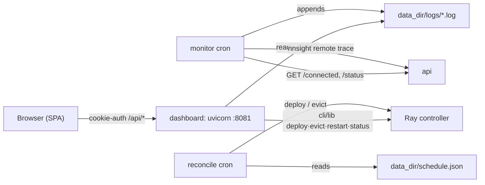

# Admin Dashboard

## What this covers

The dashboard is an optional admin web app beside the `api` and `ray` services:
a FastAPI backend (`backend/`), a Vue 3 SPA (`frontend/`), and three cron
entrypoints (`jobs/monitor.py`, `jobs/reconcile.py`, `jobs/report.py`). It gives
an operator three things the CLI doesn't — a browsable uptime/latency history,
per-replica deploy/evict/restart buttons, and a calendar that keeps a set of
models pinned over a time window.

It has no privileged channel of its own: every action goes through
`src/ndif/cli/lib/` — the same functions `ndif deploy` / `ndif evict` /
`ndif status` use — talking to the Ray controller directly. If Ray is
unreachable, the dashboard is a read-only view of its own log files.



## Bringing it up

The built frontend ships with the repo and the wheel, so `just up` serves the UI
with no build step; rebuilding it after a frontend change is covered in
[Dashboard Frontend](../developing/dashboard-frontend.md#build-and-packaging).

**With compose**, the `dashboard` service runs the same image with
`NDIF_SERVICE=dashboard`, whose default command runs `ndif start dashboard` →
`src/ndif/services/dashboard/start.sh`. The image installs `cron`, so the
container runs all three crons alongside uvicorn.

```bash
just up dashboard          # or `just up` for the whole stack
# browse http://localhost:8081/
```

Compose wires it to the rest of the stack by service name
(`NDIF_DASHBOARD_MONITOR_URL=http://api:8001`, `NDIF_RAY_ADDRESS=ray://ray:10001`,
`NDIF_REDIS_URL=redis://redis:6379`, `NDIF_API_URL=http://api:8001`) and keeps
its writable state on the named volume `dashboard_data` at `/var/lib/dashboard`.

**Standalone**, `start.sh` is the same script, minus cron:

```bash
pip install -e ".[dashboard,ray]"
export NDIF_DASHBOARD_DEV_MODE=true            # or set username + hash, below
export NDIF_RAY_ADDRESS=ray://localhost:10001
ndif start dashboard --foreground
```

`dashboard` is opt-in (`src/ndif/cli/service.py` `OPTIONAL_SERVICES`): a bare
`ndif start`, or `NDIF_SERVICE=all` in the published image, does not include it.
Name it — `ndif start dashboard`, or `NDIF_SERVICE="all dashboard"`.

## Auth

One admin user, a bcrypt-hashed password, and an HttpOnly signed session cookie.
No roles, no second account.

```bash
python -m ndif.services.dashboard.backend.auth hash 'mypassword'   # -> $2b$12$...
python -c 'import secrets; print(secrets.token_urlsafe(48))'       # session secret
```

```
NDIF_DASHBOARD_USERNAME=admin
NDIF_DASHBOARD_PASSWORD_HASH=$2b$12$...
NDIF_DASHBOARD_SESSION_SECRET=<the token from above>
```

Put these in the dashboard service's environment. In a compose `environment:`
block, write each `$` in the hash as `$$`, or compose will try to interpolate it.

**Dev mode.** `NDIF_DASHBOARD_DEV_MODE=true` makes `require_auth` return the
configured username without looking at the request at all
(`src/ndif/services/dashboard/backend/auth.py` `require_auth`). Every endpoint —
including deploy and evict — becomes anonymous. The shipped compose file sets it
so the dev stack opens without a login. **Turn it off for anything reachable by
anyone but you**, and set a real username/hash/secret in the same change.

## Env vars

`Settings` (`src/ndif/services/dashboard/backend/config.py`) reads the
`NDIF_DASHBOARD_`-prefixed fields; `start.sh` reads the port, the cron schedules
and the monitor URL when it writes the crontab.

Every variable, with defaults, is in
[Env vars — Dashboard](../reference/env-vars.md#dashboard). Three matter on
first setup: `NDIF_DASHBOARD_PASSWORD_HASH` (empty means no login can succeed),
`NDIF_DASHBOARD_SESSION_SECRET`, and `NDIF_DASHBOARD_DEV_MODE` (`true` bypasses
auth on every route). The cron jobs see only the variables `start.sh` forwards.

## The views

The SPA has four routes; `/` and any unknown path redirect to `/deployments`.

**Monitor** (`/monitor`) reads the JSONL logs the monitor cron writes: a 30-day
connectivity calendar, an average model-latency chart, a per-model 2-hour-slot
timeline, and a cluster card (nodes, GPUs, memory, what's deployed where). It
re-fetches every 5 minutes. Everything here is history from disk — nothing on
this page hits Ray.

**Deployments** (`/deployments`) is the live one. `GET /api/status` reaches the
controller directly over Ray (`src/ndif/services/dashboard/backend/routers/deploy.py`
`status_endpoint`), deliberately bypassing the API's Redis-cached `/status` so a
card refreshes accurately right after you act on it. It collapses per-replica
entries into one card per `model_key`, and tags a card `pinned` if the
controller says so *or* an active schedule event names that key. Per card you
get Deploy, Add Replica, Restart and Evict, and expanding a card gives the same
actions per replica. A COLD card opens the deploy modal (`task`, `actor_class`,
`envoy_class`, `padding_factor`, `execution_timeout_seconds`, pinned); a WARM
card redeploys the existing `model_key` with no modal.

**Schedule** (`/schedule`) is a month calendar of schedule events with a modal
to create or edit one; each entry shows its most recent reconcile status.

**Login** (`/login`). In dev mode the router never sends you here.

### Dashboard deploys are trusted

A deployment's `trusted` flag is what allows a model key asking for
`trust_remote_code` to be deployed, so a checkpoint shipping custom modeling code
can run that code inside the model actor when the deploy says
`trust_remote_code: true` (part of the key, like the task). From the dashboard:

- **Deploy and Add Replica** send `trusted: true` — the default of the
  `DeployRequest` model (`src/ndif/services/dashboard/backend/routers/deployments.py`),
  which the UI never changes. A caller of the HTTP API can send
  `trusted: false`.
- **Scheduled models** are always trusted and pinned: reconcile builds each spec
  with both hard-coded (`src/ndif/services/dashboard/jobs/reconcile.py`
  `_spec_from_event`).

Deploy from the dashboard only what you'd deploy with `ndif deploy --trusted`.
This is deploy-time trust; it does not decide where a *request's* code runs —
that is the request's own `trusted`, stamped by the API. See
[Models and Deployment](models-and-deployment.md#trusted-at-deploy-time) and
[Sandbox Execution](../concepts/sandbox-execution.md).

### Scripting the dashboard API

The same JSON endpoints the SPA calls, for a box with no browser. With login on,
get the session cookie first; in dev mode skip that step.

```bash
D=http://localhost:8081
curl -s -c jar -H 'content-type: application/json' \
  -d '{"username":"admin","password":"<password>"}' $D/api/auth/login
curl -s -b jar -H 'content-type: application/json' $D/api/deployments/deploy \
  -d '{"checkpoint":"openai-community/gpt2","trusted":false}'
curl -s -b jar -H 'content-type: application/json' $D/api/deployments/evict \
  -d '{"model_key":"<model_key>","replica":"<replica_id>"}'
```

| Endpoint | Body (`src/ndif/services/dashboard/backend/routers/`) |
|---|---|
| `POST /api/auth/login` | `{username, password}`; sets the HttpOnly session cookie |
| `POST /api/deployments/deploy` | `DeployRequest`: `checkpoint` (required), optional `model_key` (used verbatim), `trusted` (default `true`), `revision`, `task`, `actor_class`, `envoy_class`, `padding_factor`, `execution_timeout_seconds`, `pinned`, `replicas` |
| `POST /api/deployments/evict` | `EvictRequest`: `model_key`, optional `replica` |
| `POST /api/deployments/restart` | `RestartRequest`: `model_key`, optional `replica` |
| `POST /api/schedule` | `ScheduleEventIn`: `title`, `checkpoint`, `start`, optional `end` (open-ended when absent), `revision`, `task`, `actor_class`, `envoy_class`, `padding_factor`, `execution_timeout_seconds`; `model_key` is recomputed server-side |

## The schedule model

A schedule event is *one model, pinned, over a time window*. It is not a
deployment topology and not a replica count.

- **One model per event.** Want three models scheduled? Three events.
- **Always pinned** (and trusted). `pinned` means only "the controller must not
  evict this".
- **Active window is `[start, end)`.** `end: null` is open-ended — active forever
  after `start` — which is how the UI expresses "just keep this pinned".
- **Per-event fields mirror the deployment config**: `revision`, `task`,
  `actor_class`, `envoy_class`, `padding_factor`, `execution_timeout_seconds`.
- **`model_key` is server-set.** Every write resolves the checkpoint against
  HuggingFace and stamps the canonical checkpoint, revision and `model_key` onto
  the event. A typo'd repo fails the write with a 400 instead of silently failing
  on the next reconcile tick.

### What reconcile does

Each pass (`reconcile_once`), under an exclusive file lock:

1. Read `schedule.json` and filter to events active *now* — `new_keys`, keyed by
   `model_key`; read `prev_model_keys` (what the last pass pushed) from
   `.reconcile.state.json`; read the controller's current HOT keys live over Ray.
2. `to_evict = prev_keys - new_keys` → one `evict(model_keys=...)` call.
3. `to_deploy = {k in new_keys if k not in prev_keys or k not in hot_keys}` → one
   `deploy(specs, sync=False)` call. The second clause is drift recovery: a model
   pushed before but no longer HOT (NDIF restarted, someone evicted it by hand)
   is redeployed.
4. Write each event's deploy status back (`last_status` / `last_error`), persist
   the new active set, Discord-notify failures, and mirror successful specs into
   the autocomplete cache.

If the controller status read fails, the pass **does nothing and returns**.
Acting blind would make every active model look like it had drifted out of HOT
and stack a second pinned replica on the one already serving.
`python -m ndif.services.dashboard.jobs.reconcile --force` bypasses that guard
and re-pushes every active entry.

Schedule writes don't wait for the next tick: every create/update/delete queues a
reconcile as a FastAPI background task.

## The crons

`start.sh` writes `/etc/cron.d/ndif-dashboard` and starts `cron`, but only if
`cron` is on `PATH` and `/etc/cron.d` is writable. Inside the container both
hold; on a dev laptop neither does, so you get uvicorn alone and the message
`cron not available — schedules won't run from this start.sh`.

| Job | Default schedule | Output |
|---|---|---|
| monitor | `*/10 * * * *` | `logs/{connected,models,cluster}_*.log`, `logs/monitor.cron.log` |
| reconcile | `*/2 * * * *` | `logs/reconcile.cron.log` |
| report | `0 0 * * *` | `logs/report.cron.log` |

### The monitor

The monitor is end-to-end uptime data no Grafana panel produces: Grafana tells
you what *happened to traffic*; the monitor tells you whether a trace still
*works*, even on a cluster with no traffic.

Each tick probes `GET {monitor_url}/connected` then `GET {monitor_url}/status`,
calling the deployment down if either fails or if zero models are HOT
(`src/ndif/services/dashboard/jobs/monitor.py` `probe_health`), and appends one
connectivity datapoint plus one cluster snapshot. Every `--model-interval`
(default 2 hours) — or immediately on recovery from a down state — it also runs
a real nnsight remote trace of `"Hello"` against each HOT model, recording
per-model status and latency. That pass needs nnsight and an `NDIF_API_KEY`, and
is skipped with a warning without the key. Down/up transitions and changes in
the set of failing models fire Discord notifications. A `flock` on
`logs/.monitor.lock` makes a slow tick skip rather than overlap, and a 480 s
`SIGALRM` force-exits a wedged run.

Point `NDIF_DASHBOARD_MONITOR_URL` at your public API URL — the one your users
hit — rather than an internal address, so the probe exercises DNS, TLS and the
load balancer. The same URL becomes nnsight's `CONFIG.API.HOST` for the traces;
without it nnsight would default to the public NDIF service and probe that
instead of your stack.

### The daily report

`jobs/report.py` posts one digest a day answering "what happened on NDIF
today?". It probes nothing itself except a `/status` read for the HOT-model
count:

- **Uptime** from the `connected_*.log` datapoints the monitor writes, so the
  report cannot disagree with the alerts that were sent. An outage is a run of
  consecutive non-ok ticks, measured first-bad to next-good.
- **Usage** from InfluxDB — requests, completions, failures, active users,
  models, execution p50/p95 and bytes moved.

Failures are counted against *received*, not against executed, because a
request that dies before reaching a replica never emits an `execution_time`
point. Requests with no `email` tag — all of them when auth is off — are reported
as `unattributed`. If InfluxDB is unreachable you still get an uptime-only
report. Run it by hand with `--dry-run` to print instead of posting. The
top-list size is `report.top_n` in `config.json`. The
`messages.daily_report` template overrides the layout; it takes `{window}`,
`{uptime}` and `{usage}`, and a template naming any other placeholder is ignored
in favour of the built-in one.

Discord alerts are off unless `discord_webhook` is set in
`<data_dir>/config.json`, which `start.sh` seeds from `config.example.json` on
first run: webhooks, optional role id to `@`-mention, and message templates for
down / still-down / back-up / models-failed / schedule-failed / daily report.
Status alerts (down, still-down, back-up, models-failed, schedule-failed) post to
`discord_webhook`; the daily report posts to `discord_report_webhook`, or to
`discord_webhook` when that is empty. The jobs read `config.json` on every run,
so a webhook change needs no restart.

## State on disk

Everything is under `NDIF_DASHBOARD_DATA_DIR` (`/var/lib/dashboard` in compose):

| Path | Written by | What it is |
|---|---|---|
| `schedule.json` | schedule router | The events; the source of truth for reconcile |
| `.reconcile.state.json` | reconcile | `prev_model_keys`, `active_count`, `last_run` |
| `cache/values.json` | deploy + reconcile | MRU autocomplete lists (`repo_id`, `task`, `actor_class`, `envoy_class`) |
| `config.json` | you (seeded from the example) | Discord webhooks (status, report), role id, message templates |
| `logs/connected_*.log` | monitor | One JSON object per tick: timestamp + ok/reason |
| `logs/models_*.log` | monitor | One object per trace pass: per-model status, latency, error |
| `logs/cluster_*.log` | monitor | Node/GPU/memory snapshot per tick |
| `logs/.state.json` | monitor | Up/down state machine, `down_since`, `last_model_check` |
| `logs/*.cron.log` | cron | Raw stdout/stderr of each job run |
| `*.lock` sidecars | all of the above | `flock` files; safe to ignore |

The dated monitor logs keep the newest `--max-days` files per pattern
(`src/ndif/services/dashboard/jobs/util.py` `rotate_logs`).

## Gotchas

- **Dev mode is not a login shortcut, it's no auth.** With it on (the compose
  default), deploy and evict are open to anyone who can reach :8081.
- **The default session secret is a published constant.** Set
  `NDIF_DASHBOARD_SESSION_SECRET` before you disable dev mode, not after.
- **No hash means nobody can log in.** With dev mode off and
  `NDIF_DASHBOARD_PASSWORD_HASH` empty, `verify_password` always returns `False`.
- **The session cookie is set with `secure=False`.** Terminate TLS in front of
  the dashboard and don't expose :8081 directly.
- **Cron only exists in the container.** A laptop `start.sh` gives you the UI but
  no monitor history and no schedule enforcement; run
  `python -m ndif.services.dashboard.jobs.reconcile` by hand to test.
- **The dashboard and the API's `/status` can disagree briefly.** The
  Deployments page reads the controller directly; the API serves a cached blob.
  If the dashboard shows a model the API's `/status` doesn't, look at the API's
  cache.
- **The data dir must be a volume.** Without it a container rebuild discards
  every schedule event and all monitor history.
- **Reconcile needs the `ray` extra, the monitor needs `peft`/`torchvision`** for
  PEFT/VLM checkpoints. The `dashboard` extra alone installs the web app, not
  the machinery its crons drive.

## Related

- [Dashboard Internals](../developing/dashboard-internals.md) — the backend, the routers, the jobs.
- [Dashboard Frontend](../developing/dashboard-frontend.md) — the SPA, its dev server, and the build/packaging path.
- [Models and Deployment](models-and-deployment.md) — what pinning, revisions and `actor_class` mean to the controller.
- [The ndif CLI](cli.md) — the same deploy/evict/restart operations from a shell.
- [Observability](observability.md) — Loki/Grafana; the dashboard's JSONL files are a separate history.
- [Sandbox Execution](../concepts/sandbox-execution.md) — where a request's code runs, and what `trusted` changes.
