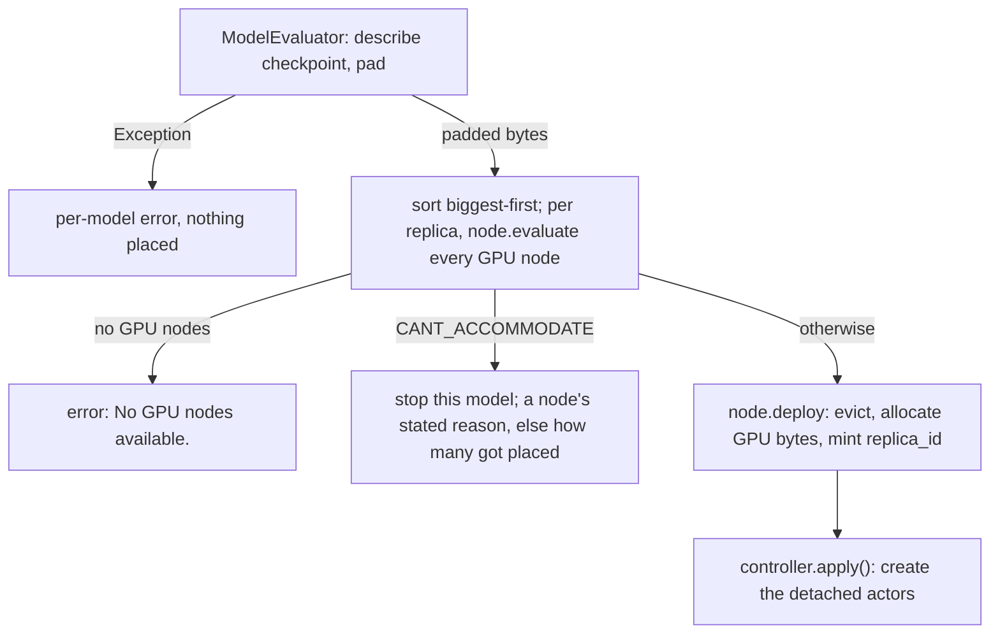

# Models and Deployment

## What this covers

Everything between "I have a HuggingFace repo id" and "a user can trace against
it remotely": how a model is named, every path that creates a deployment, the
knobs a deployment carries, how the controller decides a model fits, and how it
comes back down. [The ndif CLI](cli.md) is exhaustive on command flags; this
page is the model lifecycle. Two facts frame it:

1. **A deployment is a set of detached Ray actors, one per replica** — not Ray
   Serve, not a container. `Deployment.create` starts each with
   `namespace="NDIF", lifetime="detached"` under the name
   `{replica_id}:ModelActor:{model_key}`
   (`src/ndif/services/ray/deployments/controller/cluster/deployment.py`).
2. **Deploy is additive** — every call places `replicas` *new* replicas
   regardless of what's running (`src/ndif/common/schema/controller.py`
   `DeploymentConfig`). The only ways to shrink are `ndif evict` and
   `deploy -f ... --sync`.

## What a model key is

A model key is the server's identity for a checkpoint:
`"<nnsight wrapper class import path>:<JSON>"`, the JSON carrying the canonical
repo id, revision, and (for `TransformersModel`) the pipeline task.

```text
nnsight.modeling.transformers.TransformersModel:{"repo_id": "openai-community/gpt2", "revision": null, "task": "text-generation"}
```

`get_model_key` (`src/ndif/cli/lib/models.py`) builds it by constructing the
wrapper class on the meta device (no weights, no GPU) and calling nnsight's
`to_model_key()`. Every part is identity:

- **The repo id is canonicalized through the Hub**, so `gpt2` and
  `openai-community/gpt2` land on the same key — and deploying needs network
  access to huggingface.co, plus a token for a gated repo.
- **The revision** — two revisions are two independent deployments.
- **The task** — two tasks over one checkpoint can load different architecture
  classes (`ForCausalLM` vs `ForSequenceClassification`), so each is its own
  deployment. Left unset, the CLI infers it from the checkpoint exactly as an
  nnsight client with no `task=` does, so the two mint the same key. A model
  deployed with a non-default `--task` needs the same `--task` to evict,
  restart or scale it.
- **The wrapper class**, `nnsight.modeling.transformers.TransformersModel` by
  default (`DEFAULT_ENVOY_CLASS`).

The client sends the key it computed; the server never guesses. "Model not
deployed" is almost always a key mismatch — compare `ndif status --json-output`
with what nnsight computed locally.

## Every way a deployment is created

| Path | Code | `pinned` | `trusted` |
|---|---|---|---|
| `ndif deploy <checkpoint>...` | `src/ndif/cli/lib/deploy.py` `deploy` | `False`; `--pinned` sets it | `False`; `--trusted` sets it |
| `ndif deploy -f models.yaml` (`--sync`) | `src/ndif/cli/lib/model_config.py` `load_model_config` | per entry | per entry, default `False` |
| `ndif scale <checkpoint>` | `src/ndif/cli/lib/scale.py` `scale` → the controller's `scale` | `--pinned` | `--trusted`; other unset fields copied from a live replica |
| The queue's autoscaler | `Processor.scale_up` → `Replica.deploy` → the controller's `scale` | `False` | the Processor's `trusted` |
| Implicit, on the first request for an undeployed model | `Processor.start` → `Replica.provision` → the controller's `scale` | `False` | **the first request's `trusted`** |
| `NDIF_DEPLOYMENTS` at controller boot | `ControllerDeploymentArgs`, `deployments` | **`True`** (hard-coded) | `False` |
| Dashboard Deploy / Add Replica | `src/ndif/services/dashboard/backend/routers/deployments.py` `DeployRequest` | per request | **`True` by default** (a field an API caller can set) |
| Dashboard schedule reconcile cron | `src/ndif/services/dashboard/jobs/reconcile.py` `_spec_from_event` | **`True`** (hard-coded) | **`True`** (hard-coded) |

The implicit path matters most. When a request arrives for a model with no HOT
replica, `Processor.start` asks the controller for replicas and, finding none,
calls `Replica.provision`, which asks the controller to scale the model by one
with `DeploymentConfig(trusted=processor.trusted)`
(`src/ndif/services/api/queue/replica.py`). **You do not have to pre-deploy
anything** — a user's first `remote=True` trace pulls the model down and loads
it. Pre-deploying and pinning control *which* models stay warm.

`scale` (and therefore the autoscaler and the implicit path) differs from
`deploy` only in where unspecified settings come from: `deploy` uses the
controller's defaults, `scale` copies a live replica (`_like_existing` in `controller.py`),
so growing a tensor-parallel or non-default-dtype model gives more of the same.
With nothing running there is nothing to copy and it behaves as a plain deploy.

`NDIF_DEPLOYMENTS` is a `|`-separated list of **model keys**, not checkpoints,
read raw on the `ray` service and deployed pinned. Each entry must be the exact
current key — including the task — as `ndif status --json-output` prints it. A
bare checkpoint fails to evaluate, and a key without the task deploys a model no
client's key will ever match.

### models.yaml

`deploy -f` takes a `models:` list whose entries are a bare checkpoint string or
a mapping:

```yaml
models:
  - gpt2
  - checkpoint: meta-llama/Llama-3.1-8B
    revision: null
    task: text-generation   # part of the model key; inferred when unset
    pinned: true
    replicas: 2
    trusted: false
    dtype: bfloat16
    padding_factor: 0.15
    execution_timeout_seconds: 3600
    # Placement overrides — each replaces one step the controller would derive.
    gpus: 4
    size_bytes: 6425499648
    padding_bias: 2000000000
    max_tp: 8
    envoy_class: nnsight.modeling.transformers.TransformersModel
    actor_class: ndif.services.ray.sandbox.model.SandboxModelActor
    model_key: null          # a precomputed key skips the Hub lookup
```

`load_model_config` passes every field above through; any other key is silently
dropped. A per-entry value overrides the matching CLI flag. An entry without
`task:` takes `--task` when given, else the task inferred from the checkpoint as
a client infers it, so most entries need no `task:`. Only a verbatim
`model_key:` must spell the task out. `--sync` reconciles
instead of adding: `_sync_reconcile` (`src/ndif/cli/lib/deploy.py`) evicts every
HOT model key not in the file, trims replicas above the requested count, and
reduces each remaining spec to the shortfall so the additive deploy that follows
adds only what's missing.

## Per-model configuration

Everything the controller stores about a deployment is `DeploymentConfig`
(`src/ndif/common/schema/controller.py`). Revision and task are not here —
they're in the model key.

| Field | Default | Falls back to | Effect | Set by |
|---|---|---|---|---|
| `pinned` | `False` | — | Exempt from controller-initiated eviction (`Node.evictable`). | CLI, yaml, dashboard |
| `replicas` | `1` | — | How many **new** replicas this call places. | CLI, yaml, dashboard |
| `trusted` | `False` | — | Becomes `trust_remote_code` at size and load. See below. | CLI `--trusted`, yaml, dashboard, implicit deploy |
| `padding_factor` | `None` | `NDIF_DEFAULT_PADDING_FACTOR` = `0.15` | Headroom on top of the weight size. | CLI, yaml, dashboard |
| `padding_bias` | `None` | `NDIF_DEFAULT_PADDING_BIAS` = 500 MiB | Flat headroom, per model rather than per cluster. | CLI, yaml |
| `size_bytes` | `None` | estimated from the checkpoint | The model's own weights, measured. Skips the Hub, so a deploy that names its size places with the Hub unreachable. Padding still applies. | CLI, yaml |
| `gpus` | `None` | derived from the padded size | Place on exactly this many cards. Refused if the model cannot split into that many. | CLI, yaml |
| `max_tp` | `None` | read from the checkpoint's config | Largest tensor-parallel degree. `0` never places it tensor-parallel. | CLI, yaml |
| `dtype` | `None` | `NDIF_DEFAULT_DTYPE` = `bfloat16` | How the weights are held — a torch dtype or a quantization name. Used to load **and** to size. | CLI, yaml |
| `execution_timeout_seconds` | `None` | `NDIF_DEFAULT_EXECUTION_TIMEOUT_SECONDS`, unset by default (no cap) | Per-request wall clock on the actor; on expiry the user gets `ERROR`. Set it on a shared deployment. | CLI (`scale`), yaml, dashboard |
| `actor_class` | `None` | `NDIF_MODEL_IMPORT_PATH`, then `NDIF_DEFAULT_MODEL_ACTOR_CLASS` | Dotted path of the Ray actor class. Explicit wins over the TP choice. | CLI, yaml, dashboard |

**The placement fields are overrides, not requirements.** Supply any part of the
derivation and the rest is still worked out. Without them the only lever is
`padding_factor`, which means expressing "give this model four cards" as a fudge
factor computed against the cluster's card size.

All cluster-wide defaults come from `ControllerDeploymentArgs`
(`src/ndif/services/ray/deployments/controller/controller.py`); see
[Environment Variables](../reference/env-vars.md). The controller pins `dtype`
to a concrete value on every deploy before anything else, so the evaluator's
estimate and the actor's load agree.

## `dtype` — quantization is a dtype name

`--dtype nf4` (or `int4`, `4bit`, `fp4`, `int8`, `8bit`, `fp8`) deploys the model
with its weights held that narrow. Nothing else about the deployment changes,
and nothing client-side does either: module paths and activations match an
unquantized replica. The names and widths come from nnsight
(`nnsight.modeling.quantization.QUANTIZATIONS`), the same table the loader
builds its quantizer config from, so sizing and loading accept the same set.

- **The size estimate runs low, by more than `padding_factor` covers.** The
  estimate is parameters times nominal width, but the format leaves embeddings,
  norms and the LM head in 16 bits and stores a scale per block. On
  Llama-3.2-1B, `nf4` estimates 0.62 GB against 1.07 GB really allocated, `int8`
  1.24 against 1.50, where `bfloat16` is exact. Give a quantized deploy a
  measured `size_bytes` or a padding factor worked out on your hardware.
- **A client cannot ask for it.** Quantization is not part of the model key, so
  two dtypes of one checkpoint are the same model as far as routing is concerned.
- **It composes with tensor parallelism.** transformers shards the packed
  weights and nnsight's gather works through them, so a remote trace reads a
  full-width activation, not one rank's slice. A 70B model at `nf4` over four
  cards holds roughly 43 GB in total against ~141 GB at bfloat16. Every rank is
  handed the same dtype name, so they quantize identically.

## `trusted` at deploy time

`trusted` on a *deployment* decides how its weights load; `trusted` on a
*request* decides where that request's code runs. They are separate flags that
share a name. The request side — where it comes from and what the sandbox
changes — is in [Auth and Limits](../concepts/auth-and-limits.md) and
[Sandbox Execution](../concepts/sandbox-execution.md).

**At load**, `DeploymentConfig.trusted` becomes `trust_remote_code=` both on the
evaluator's meta build and on the actor's load (`Cluster.deploy` in
`src/ndif/services/ray/deployments/controller/cluster/cluster.py`). So **an
untrusted deploy of a model whose HF repo ships custom modelling code fails** —
anything with `"auto_map"` in its `config.json`. Transformers refuses to run a
repo's `modeling_*.py` without `trust_remote_code=True`, and the failure lands in
the evaluator, before any GPU is touched: the cluster records it as that model's
`error`, and `ndif deploy` prints `✗ <model_key>: <traceback>` with nothing
placed. Architectures built into transformers (GPT-2, Llama, Qwen) load fine
untrusted. The evaluator caches per `(dtype, trust_remote_code)` and recomputes
when either changes, since repo code can build a different architecture.

Where a deployment's `trusted` comes from is the last column of the table
above. Two consequences:

- **The dashboard deploys trusted by default**, so anything deployed or
  scheduled from the UI loads with `trust_remote_code=True`. Deploy from it only
  what you'd deploy with `--trusted` from a shell.
- **An implicit deploy inherits the first request's flag.** With auth off a
  default request is trusted, so a bare `just up` loads models with
  `trust_remote_code`. With auth on, an untagged key's first request yields an
  untrusted deployment, and a later trusted request against that model does
  *not* reload it — evict and redeploy with `--trusted` if the model needs it.

## How a deploy is accepted



**Sizing.** `ModelEvaluator` asks nnsight to describe the checkpoint — its size,
parameter count, config and revision, answered from the Hub's published
parameter count and falling back to a meta build for a repo that publishes none.
Then it pads: `ceil(base + base * padding_factor + padding_bias)` — by default
weights + 15% + 500 MiB, standing in for the CUDA context, activations and KV
cache. A heuristic: a model with unusually large activations for its weight
count can still OOM at run time, and nothing here reads live GPU memory.

**Placement.** `Node.evaluate` computes `ceil(size / per_gpu_memory)` cards (or
takes `gpus`), rounds that up to a degree the model shards into when it will be
tensor-parallel, and charges each card its **share**, `ceil(size / gpus)`. So
several models share a GPU whether or not any of them is multi-card. Each node
scores itself with a `CandidateLevel`, lower better: `CACHED_AND_FREE` (WARM
here *and* free GPU room) < `FREE` < `CACHED_AND_FULL` (WARM, but something must
be evicted) < `FULL` < `CANT_ACCOMMODATE`. Ties across nodes break at random.
When the best is `CANT_ACCOMMODATE`, the error is a node's stated reason if it
gave one (a `gpus` count the model cannot split into, say), else
`CANT_ACCOMMODATE: placed N of M new replicas ...`.

The accounting is the controller's own bookkeeping, seeded from each node's
total GPU memory and decremented per placement — anything using GPU memory
outside this controller is invisible to it. WARM weights live in a separate
budget, `NDIF_MODEL_CACHE_PERCENTAGE` of the node's CPU RAM. Diagnosing a
refusal is [Model OOM on deploy](../runbooks/model-oom-on-deploy.md).

## Tensor parallelism

**Off unless you turn it on.** Set `NDIF_TP_MODEL_ACTOR_CLASS` on the `ray`
service. Unset, no replica is ever placed tensor-parallel, no GPU count is
rounded up, and `max_tp` does nothing. It is opt-in because a sharded replica
cannot be cached and needs transformers >= 5.15.

With it on, a multi-GPU replica is served one of two ways, chosen by the
controller. **Tensor-parallel** — each layer's weights split across the cards —
when the replica got more than one GPU *and* the model shards evenly into
exactly that many (the evaluator reads the largest degree off the checkpoint's
config; workable counts are its divisors). A model needing three cards and
shardable eight ways is given four. **Everything else** gets the default actor,
which spreads whole layers over the cards with accelerate.

- **A TP replica is never cached.** Every rank's device is fixed at process
  start, so it cannot be parked HOT→WARM; the controller evicts it outright. Pin
  one you want to keep.
- **The TP class replaces the actor class.** `ndif.services.ray.tp.model.TPModelActor`
  runs untrusted code in-process; on a cluster that takes untrusted traffic use
  `ndif.services.ray.tp.model.SandboxedTPModelActor`, which runs untrusted
  requests in one runner process every rank hosts.
- **transformers >= 5.15** is required; below it a tied LM head returns logits
  `tp_size` times too wide, with a plausible argmax.

`max_tp: 0` keeps one deployment off it; `gpus:` chooses the count. How the
group runs is in `src/ndif/services/ray/tp/ARCHITECTURE.md`.

## Pinning, eviction, and the minimum-deployment-time rule

Levels: **HOT** (weights on GPU, serving), **WARM** (offloaded to host RAM, GPU
released), **COLD** (present only in the local HF cache). Only HOT replicas are
returned by the controller's `get_deployment`, which is what the queue asks; an actor
told to run while cached raises `CachedActorError`. A HOT→WARM demotion keeps
the `replica_id`, so the actor name stays stable. What the controller may evict
on its own is decided by `Node.evictable`
(`src/ndif/services/ray/deployments/controller/cluster/node.py`):

- **A pinned deployment is never evicted *by the controller*** — not to make
  room, not by autoscaling. It says nothing about an explicit eviction.
- **A deployment younger than `NDIF_MINIMUM_DEPLOYMENT_TIME_SECONDS` (3600s) is
  protected** — unless the incoming model is itself pinned, which waives the
  rule.

The age rule stops thrash between two models that don't co-fit, and means a
fresh non-pinned deploy can be blocked for an hour behind another — pin the
incoming model or evict by hand. Evicting a HOT replica releases its GPU bytes
and demotes it to WARM if CPU cache room exists or can be freed; otherwise it is
removed outright.

## Evicting, checking, exporting

```bash
ndif evict gpt2                 # every HOT + WARM replica of gpt2
ndif evict gpt2 --replica abc12 # one replica (exactly one checkpoint)
ndif evict --all                # every HOT deployment, pinned included
ndif status --json-output       # raw controller payload — model keys live here
ndif export --stdout > models.yaml  # current HOT set as a models.yaml
```

Explicit eviction is unconditional — it respects neither `pinned` nor the age
rule. It resolves checkpoints to keys the same way deploy does (task inferred
when `--task` is absent), so it needs Hub access. Deploy and evict then publish
a Redis reconcile event so live dispatcher `Processor`s refresh their replica
pools (`src/ndif/cli/lib/events.py` `notify_reconcile`).

`ndif status --json-output` gives, per replica: `model_key`, `replica_id`,
`deployment_level`, `application_state` (`RUNNING`/`DEPLOYING`/`UNHEALTHY`,
from Ray's actor states), `task`, `pinned`, `trusted`, `dtype`,
`execution_timeout_seconds`, `actor_class`, `gpus`, `n_params`, `size_bytes`,
and — for non-pinned deployments — `schedule.end_time`, when age protection
lapses (the controller's `status`).

**What `ndif export` round-trips.** It collapses the HOT replicas into one entry
per model key (`src/ndif/cli/commands/export.py` `_aggregate_by_model_key`) and
writes `revision`, `pinned`, `replicas` (the live count), `trusted`, `dtype`,
`execution_timeout_seconds`, `gpus` (when more than one), `actor_class` and the
full `model_key` — which carries the task and envoy class, and is used verbatim
on redeploy. It does **not** carry `padding_factor`, `padding_bias`,
`size_bytes` or `max_tp`: those are deploy-time sizing inputs that are never
stored on the deployment, so a restored model is re-sized from the cluster
defaults unless you add them back to the file.

Fields are written only when they differ from the defaults. Replicas under one
key with different settings (say one pinned, one not) are merged into one entry,
so a restore can differ from what ran; if that matters, save the per-replica
state from `ndif status --json-output` first. `ndif export -f` writes its file
where the CLI runs — inside the `ray` container on compose — so use the stdout
form to get it onto the host:
`docker exec dev-ray-1 ndif export --stdout > models.yaml`.

## PEFT adapters

Adapters are **per request, not per deployment** — `DeploymentConfig` has no
adapter field. The client instantiates `TransformersModel(repo,
peft="<adapter repo id>")`; nnsight puts `{"peft": ...}` in the request's `env`,
and the actor applies it before every run through the model's
`_remoteable_set_env` (`BaseModelDeployment.run`). nnsight swaps only when the
requested adapter differs from the current one, so one deployment of `gpt2`
serves every LoRA over `gpt2`.

`peft` is part of the `ray` extra, so the server has it; the adapter is fetched
from the Hub by id at first use, so a local adapter path on the client is
invisible to the server. The **client** needs `peft` too, to graft the adapter's
architecture onto its meta model so its module paths match the server's. A bad
adapter id surfaces as a normal user-facing `ERROR` with the real message.

## Worked example

On the compose stack, deploy gpt2 pinned, check it, and take it back down:

```bash
in-ray() { docker exec -i dev-ray-1 "$@"; }      # a function: an alias only works interactively
in-ray ndif deploy openai-community/gpt2 --pinned   # prints the model key, then ✓ ready
in-ray ndif status                                  # 🔥 HOT (1) • openai-community/gpt2 RUNNING | text-generation
in-ray ndif evict openai-community/gpt2
```

A client reaches it with
`TransformersModel("openai-community/gpt2", task="text-generation")` from
`nnsight.modeling.transformers`, as in
[Quickstart](quickstart.md#run-a-remote-trace); the task must match the key.

## Gotchas

- **`ndif deploy` runs where Ray is reachable** — inside the `ray` container, or
  from the host with matching Python and Ray — and needs Hub access to
  canonicalize the checkpoint.
- **`--replicas N` means "add N", not "have N"**, even under `--sync` (which
  computes the shortfall first).
- **`ndif evict --all` sweeps pinned deployments too**, and reads only the HOT
  set.

## Related

[Deployments and Eviction](../concepts/deployments-and-eviction.md) is the
mental model behind the levels and the eviction policy;
[The ndif CLI](cli.md) covers every command and [Admin Dashboard](dashboard.md)
the deploy/evict buttons and schedule calendar.
[Queue and Scheduling](../concepts/queue-and-scheduling.md) explains how a
request finds a replica and triggers the implicit deploy. For code,
[Controller Internals](../developing/controller-internals.md) and
[Model Actor](../developing/model-actor.md); for recipes,
[Deploy and pin a model](../runbooks/deploy-and-pin-a-model.md) and
[Model OOM on deploy](../runbooks/model-oom-on-deploy.md).
