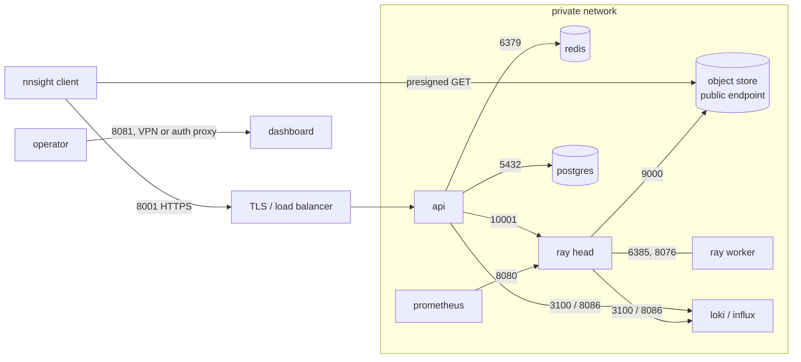

# Ports

## What this covers

Every TCP port an NDIF process binds, plus the ports of the backing services the
stack connects to. For each: what speaks it, which environment variable moves it,
whether `docker/docker-compose.yml` publishes it to the host, whether the
published image `EXPOSE`s it, and whether it should be reachable from outside
your network in a real deployment.

Two things frame the table. First, **the dev compose publishes almost
everything** — Redis, Postgres, Grafana, the Ray client port and the Ray
dashboard are published on every host interface with no authentication, because
it's a single-machine development stack. None of that survives contact with a real network. Second, **Ray brings
its own port map**, and only some of it is env-driven; `ray/start.sh` passes five
explicit port flags and lets Ray default the rest.

## NDIF services

| Port | Service | Protocol | Purpose | Env var | Host-published (dev compose) | Public in prod |
|---|---|---|---|---|---|---|
| 8001 | api | HTTP + WebSocket | The only port a client touches: request submit, `/status`, `/env`, `/ping`, and the per-request status websocket. Bound on `0.0.0.0` by gunicorn (`src/ndif/services/api/gunicorn_conf.py` `bind`). | `NDIF_API_PORT` | yes — `8001:8001` (compose `api` `ports`) | **yes**, behind TLS and a load balancer |
| 8081 | dashboard | HTTP | Admin UI + its FastAPI backend (deploy/evict/status, schedules, monitor). Bound on `0.0.0.0` by uvicorn (`src/ndif/services/dashboard/start.sh`). Optional: not part of `NDIF_SERVICE=all`. | `NDIF_DASHBOARD_PORT` | yes — `8081:8081` (compose `dashboard` `ports`) | no — admin network or an authenticating proxy only |

Two internal channels bind no fixed port. A sandboxed model actor talks to its
runner over a Unix socket at `/tmp/sbx-<hex>.sock`
(`src/ndif/services/ray/sandbox/host.py` `spawn`). A tensor-parallel group's rank 0
drives its shards over Unix sockets too, and the group's torch.distributed
rendezvous binds `127.0.0.1` on an ephemeral `MASTER_PORT` the OS picks per group
(`src/ndif/services/ray/tp/host.py` `_free_port`, set in `ShardGroup.__init__`),
so nothing needs opening for either.

## Ray

All of these are set (or deliberately not set) by
`src/ndif/services/ray/start.sh`. Only the head node binds the head-only ports;
a worker joins with `ray start --address` and lets Ray choose the rest.

| Port | Role | Protocol | Purpose | Env var | Host-published (dev compose) | Public in prod |
|---|---|---|---|---|---|---|
| 6385 | head | Ray GCS | The cluster's control plane. Workers join here — this is the `HOST:PORT` you put in `NDIF_RAY_HEAD_ADDRESS`. 6385 is the default from both the CLI's `DEFAULTS` (`src/ndif/cli/config.py` `DEFAULTS`) and `start.sh`'s own fallback. | `NDIF_RAY_HEAD_PORT` | no | no — cluster-internal, but must be reachable from every worker |
| 10001 | head | Ray client (gRPC) | The `ray://` client server. This is what `NDIF_RAY_ADDRESS` points at, and how the API, dashboard and CLI drive the controller. **Not configurable through an NDIF variable** — `start.sh` never passes `--ray-client-server-port`, so it stays at Ray's own default. | none (address side: `NDIF_RAY_ADDRESS`) | yes — `10001:10001` (compose `ray` `ports`) | no — anyone who can reach it can run arbitrary code on the cluster |
| 8265 | head | HTTP | Ray dashboard, bound on `0.0.0.0` (`--dashboard-host`). | `NDIF_RAY_DASHBOARD_PORT` | yes — `8265:8265` (compose `ray` `ports`) | no |
| 8080 | head | HTTP | **Ray metrics export** — the Prometheus scrape target. Passed as `--metrics-export-port`; Prometheus scrapes `ray:8080` over the compose network (`docker/prometheus/prometheus.yml`). This is not a Ray Serve port; NDIF does not use Serve. | `NDIF_RAY_METRICS_PORT` | no | no |
| 8076 | head | Ray object manager | Plasma object transfer between nodes (`--object-manager-port`). | `NDIF_RAY_OBJECT_MANAGER_PORT` | no | no — cluster-internal, needs to be open between nodes |
| 52366 | head | gRPC | Ray dashboard agent (`--dashboard-agent-grpc-port`). | `NDIF_RAY_DASHBOARD_GRPC_PORT` | no | no |

Every other Ray port — the raylet's node-manager port, the per-node dashboard
agent HTTP port, and the worker port range — is left at Ray's default because
`start.sh` doesn't pass a flag for it. On a multi-node cluster those still have
to be open between nodes; consult Ray's own port documentation rather than
guessing, since this repo doesn't pin them.

> **Gotcha:** Ray's own GCS default is 6379, Redis's port; NDIF moves it to 6385
> so one host can run both. A worker's `NDIF_RAY_HEAD_ADDRESS` must name the port
> the head actually bound, and setting `NDIF_RAY_HEAD_PORT=6379` beside a Redis
> puts the collision back. Separately, in compose nothing listens on
> `localhost:6379` inside the `ray` or `api` container — Redis is its own
> container — so every service is given `NDIF_REDIS_URL=redis://redis:6379`.

## Backing services

| Port | Service | Protocol | Purpose | Env var | Host-published (dev compose) | Public in prod |
|---|---|---|---|---|---|---|
| 6379 | redis | RESP | Request queue, response pub/sub, status/env caches, trigger streams. | address side: `NDIF_REDIS_URL`; the CLI starts `redis-server` on that URL's port (`src/ndif/cli/service.py` `_redis_command`) | yes — `6379:6379` (compose `redis` `ports`) | no |
| 9000 | minio | HTTP (S3) | Result blobs. Servers upload here; clients download via presigned GET URLs. | address side: `NDIF_OBJECT_STORE_URL` / `NDIF_OBJECT_STORE_PUBLIC_URL`; the CLI's MinIO takes the URL's port (`_minio_command`) | yes — `9000:9000` (compose `minio` `ports`) | **yes** — clients must be able to reach whatever host `NDIF_OBJECT_STORE_PUBLIC_URL` names |
| 9001 | minio | HTTP | MinIO web console. Compose hardcodes `--console-address ":9001"` in the `minio` `command`; only a CLI-spawned MinIO reads the variable. | `NDIF_OBJECT_STORE_CONSOLE_PORT` (CLI only) | yes — `9001:9001` (compose `minio` `ports`) | no |
| 5432 | postgres | Postgres wire | User/API-key database for auth. Nothing connects unless `NDIF_POSTGRES_URL` is set — the dev compose leaves it commented out on the `api` service. | address side: `NDIF_POSTGRES_URL` | yes — `5432:5432` (compose `postgres` `ports`) | no |
| 3100 | loki | HTTP | Log ingest (`/loki/api/v1/push`) and query. Services ship here only when `NDIF_LOKI_URL` is set. | address side: `NDIF_LOKI_URL` | yes — `3100:3100` | no |
| 8086 | influxdb | HTTP | Metrics write API (InfluxDB 2.x). | address side: `NDIF_INFLUX_URL` | yes — `8086:8086` | no |
| 9090 | prometheus | HTTP | Prometheus UI and API; scrapes `ray:8080` every 10s (`docker/prometheus/prometheus.yml`). | none | yes — `9090:9090` | no |
| 3000 | grafana | HTTP | Dashboards over Loki, Influx, Prometheus and Postgres. The dev compose enables **anonymous admin** and disables the login form (compose `grafana` `GF_AUTH_*`). | none | yes — `3000:3000` | no — not until you turn the login form back on |

## The published image

`docker/Dockerfile` declares the seven ports a container may need in **any**
`NDIF_SERVICE` mode:

```dockerfile
EXPOSE 8001 9000 9001 8081 8265 10001 6379
```

`EXPOSE` is documentation, not a publish — `docker run` still needs `-p`. Read it
as the union of two different deployments:

| Port | Reached in `NDIF_SERVICE=api`/`ray`/`dashboard` | Reached in `NDIF_SERVICE=all` |
|---|---|---|
| 8001 | the `api` container | the one container |
| 8081 | the `dashboard` container | **not bound** — the dashboard is optional and not in `all`; set `NDIF_SERVICE="all dashboard"` to add it |
| 8265, 10001 | the `ray` container | the one container |
| 9000, 9001 | the separate `minio` container | **the one container** — the image carries the `minio` server binary, copied from the pinned `quay.io/minio/minio` image, and the CLI spawns it |
| 6379 | the separate `redis` container | **the one container** — `redis-server` is installed from apt and the CLI spawns it on the port in `NDIF_REDIS_URL` |

`NDIF_SERVICE` defaults to `all` in the image, so a bare
`docker run --gpus all ndif/ndif` binds every port in that list except 8081. Compose sets
`NDIF_SERVICE` per container and runs redis and minio as their own services, so
the in-image copies never start there.

> **Not exposed, and deliberately:** 8080 (Ray's metrics export), 8076 (Ray's
> object manager), 52366 (the Ray dashboard agent), and Ray's defaulted
> raylet/worker range. A single-container run needs none of them from outside;
> a multi-node cluster needs them between nodes, which is a network-level
> decision, not an image-level one.

## Reading the compose file

Only ports listed under a service's `ports:` key are reachable from the host.
Everything else is reachable *only* by container name on the compose network —
which is why the API is configured with `redis://redis:6379` and
`ray://ray:10001` rather than `localhost`. Prometheus scrapes `ray:8080` even
though 8080 isn't published, for exactly this reason.

The `api` service's healthcheck hits `/ping` on 8001 from inside the container
(the image has no `curl`; python makes the request). `/ping` only proves the web
process is up; `/connected` is the readiness signal, so `api` reports healthy
before it can serve a request — see [http-api.md](http-api.md).

## What to expose in a real deployment



Two ports face users: the API (8001) and the object store's public endpoint.
Everything else — Ray client and GCS, Redis, Postgres, Loki, Influx, Prometheus,
Grafana, both dashboards — belongs on a private network or behind
authentication. The Ray client port is the sharpest edge: `ray://` has no
authentication of its own, so exposing 10001 hands the cluster to anyone who can
route to it.

For a multi-node cluster, open 6385 (GCS), 8076 (object manager) and Ray's
default raylet/worker range **between nodes only**. A worker needs no inbound
access from anywhere else; `start.sh` only ever dials *out* to the head.

## Related

- [env-vars.md](env-vars.md) — every variable named above, with defaults and
  the symbol that reads it.
- [compose-stack.md](../operating/compose-stack.md) — the dev compose service by
  service; [§ Service names, not localhost](../operating/compose-stack.md#service-names-not-localhost)
  covers which service needs which address.
- [production.md](../operating/production.md) — moving off the dev compose:
  multi-node Ray, real auth, a real object store.
- [add-a-gpu-node.md](../runbooks/add-a-gpu-node.md) — the worker-join procedure
  that depends on 6385 being reachable.
