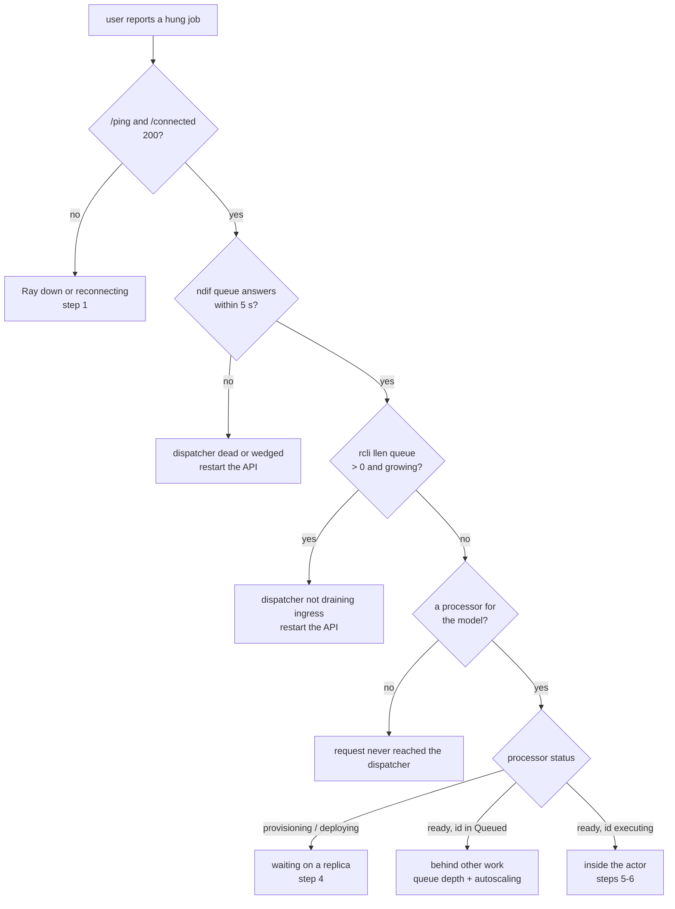

# Debug a Stuck Request

## What this covers

"My job has been sitting there for twenty minutes." This page walks the request
from the id on the user's screen to the component that is blocked, and ends with
how to unstick it.

Where the evidence lives:

1. **Request status is not stored in Redis.** A blocking request's statuses are
   published on a pub/sub channel named after the client's `session_id` and are
   gone if nobody listens; a non-blocking request's latest status is written to
   the object store at `responses/{request_id}.json`
   (`src/ndif/common/schema/request.py` `BackendRequestModel.respond`). There is no
   per-request key to `GET`.
2. **The live state is in the dispatcher's memory**, and `ndif queue` reads it:
   the CLI posts an event on the `dispatcher:events` Redis stream and waits 5 s for
   the reply (`src/ndif/cli/lib/events.py` `fetch_queue_state`).
3. **Redis holds only the ingress list**, `queue` (`NDIF_QUEUE_KEY`), between the
   API workers and the dispatcher. It is usually empty because the dispatcher
   pops it continuously. Once popped, a request lives in a per-model priority
   queue inside the dispatcher.
4. **The dispatcher is one process**, spawned by the gunicorn master in the `api`
   container (`src/ndif/services/api/gunicorn_conf.py` `on_starting`). Nothing
   restarts it if it dies, and the `ray:connected` flag it sets has no TTL — so
   `/ping` and `/connected` can pass while nothing is dispatching. Its logs are in
   `just logs api`.

`ndif` commands run wherever the CLI reaches Redis and `NDIF_RAY_ADDRESS`. On the
compose stack:

```bash
# a function, not an alias: works in scripts and from any directory (project `dev`)
ndif() { docker exec -i dev-ray-1 ndif "$@"; }
rcli() { docker exec -i dev-redis-1 redis-cli "$@"; }
```

## Step 0 — get the request id

The client prints it in brackets before each status:
`[3f9c1e2b...] QUEUED  Added to Queue at position 2.` Ask for that line or the
whole console output. Without it, `ndif queue` still lists every queued and
executing id.

## The decision tree



## Step 1 — is the backend up?

```bash
curl -s localhost:8001/ping                                   # "pong": the web process is alive
curl -s -o /dev/null -w '%{http_code}\n' localhost:8001/connected
rcli get ray:connected                                        # "1" while the dispatcher holds Ray
```

`/connected`, `/request`, `/status` and `/env` 503 unless `ray:connected` is set
(`src/ndif/services/api/app.py` `require_ray_connection`). The dispatcher deletes
the flag when it starts reconnecting and sets it once Ray answers
(`src/ndif/services/api/queue/dispatcher.py` `Dispatcher.connect`).

**If the flag is missing**, the dispatcher is retrying Ray once a second, and it
has already **purged every Processor**: every queued and executing request was
answered `ERROR` "Critical server error occurred…" (`Dispatcher.handle_errors`,
`Processor.purge`). A user still waiting at this point has a client that isn't
receiving — a websocket problem, not a queue problem.

## Step 2 — is the dispatcher alive and draining?

```bash
ndif queue          # must answer within 5 s
rcli llen queue     # 0, or a small transient number
```

| Symptom | Meaning | Fix |
|---|---|---|
| `ndif queue` prints `No response from the dispatcher for queue_state_request. Is the API running?` | the dispatcher process is dead or its event loop is wedged; the flag and `/ping` still look healthy | `just restart api` |
| `llen queue` stays above zero and grows | the dispatcher isn't popping | `just restart api` |
| `/connected` 200 and `ndif queue` answers, but requests never get past `QUEUED`/`DISPATCHED` while `ndif status` (a separate Ray client) works | the dispatcher's Ray connection is dead without having raised | `just restart api` |

Restarting the API kills the dispatcher, and with it every request it had popped:
those users get no further status and must resubmit. `just restart api` is right
here because nothing in the environment changed. Check `just logs api` for the
dispatcher's last lines first.

## Step 3 — ask the dispatcher

```bash
ndif queue
```

```
NDIF Queue Status
============================================================

Overview:
  Active processors: 1
  Queued requests: 3
  Executing: 1

  openai-community/gpt2 (text-generation)
    Status: READY
    Replicas: 1
    Queue depth: 3
    ⚙ [a1b2c] executing 3f9c1e2b8d4a4c0e9b1f2d3c4b5a6978 (for 0:18:07)
    Queued: 7d21c9e04b6f4e2a8c3d5f1a9b0e7c64, 9ff0a3b2c1d84e5f9a6b7c8d0e1f2a3b, 41ab6c7d8e9f4a0b1c2d3e4f5a6b7c8d

------------------------------------------------------------
Use 'ndif queue --json-output' for raw data
```

Everything here comes from `Processor.snapshot`
(`src/ndif/services/api/queue/processor.py` `Processor.snapshot`). The status line
carries no duration; the executing line does. `Queued:` lists the first three ids
in service order, then `... (+N more)`.

**No processor for the model.** The dispatcher creates one on the first request
it pops for that model. None means the request never got there: it is still on
the ingress list (step 2), it was rejected at the API (401/403/422/503 — see
[Trace a user's failed job](trace-a-users-failed-job.md)), or the user is on a
different NDIF — or under a different key: the processor line shows the task and
`trust_remote_code` from the model key, and a client that loaded the model with
another task or `trust_remote_code` value asks for a different deployment.

**`UNINITIALIZED`.** The pool is empty and nothing is provisioning. A processor
goes idle here when its last replica exits with an empty queue. Queued requests
with this status mean provisioning failed and `purge` errored them — look for
`Error provisioning model` / `Error starting model` under `ndif.queue.processor`.

**`PROVISIONING` / `DEPLOYING` for a long time.** `PROVISIONING` is the controller
placing a replica; `DEPLOYING` is waiting for the replica's actor to be ready.
`Processor.start` has **no timeout**: `Replica.wait` waits for as long as the actor
is loading or restarting (`src/ndif/services/api/queue/replica.py` `Replica.wait`).
A big model loading legitimately takes minutes. A replica whose actor is gone fails
the wait, and the queued requests get an error.
Go to step 4.

**`READY`, the id is in `Queued:`.** The request is behind other work. Each model's
queue is FIFO within two groups: requests from `priority`-tagged keys are served
before everyone else, FIFO among themselves, and a request handed back by an
evicted replica goes to the front of its own group
(`src/ndif/services/api/queue/request_queue.py` `RequestQueue.rank`).
Autoscaling: every `NDIF_AUTOSCALING_INTERVAL_S` (5 s) the processor checks the
longest-waiting queued request; past `NDIF_AUTOSCALING_WAIT_THRESHOLD_S` (30 s) it
adds a replica, up to `NDIF_AUTOSCALING_MAX_REPLICAS` (3), then waits
`NDIF_AUTOSCALING_BACKOFF_S` (120 s) (`Processor.autoscaling_loop`). Depth high and
`Replicas:` stuck at 1 → look for `Autoscaling … failed to add replica` in the API
logs; usually the cluster has no room —
[Model OOM on deploy](model-oom-on-deploy.md).

**`READY`, the id is on the `⚙ … executing` line.** Note the duration and the
replica id in brackets, and go to step 5.

## Step 4 — is there a live replica?

```bash
ndif status --json-output | jq '.deployments[] |
  select(.repo_id=="openai-community/gpt2") |
  {level: .deployment_level, state: .application_state, replica: .replica_id, task, pinned}'
```

- `deployment_level` is the controller's bookkeeping: `HOT` holds GPU memory,
  `WARM` holds weights in CPU RAM, `COLD` is only in the local HuggingFace cache.
- `application_state` is the Ray actor's state from `list_actors()`: `ALIVE` →
  `RUNNING`; `PENDING_CREATION` / `RESTARTING` / `DEPENDENCIES_UNREADY` →
  `DEPLOYING`; `DEAD` → `UNHEALTHY`. Ray keeps a dead record beside a restarted
  actor; the healthiest state wins, so `UNHEALTHY` means no live actor at all
  (`src/ndif/services/ray/deployments/controller/controller.py`
  `_ControllerActor.status`).

| level | state | Meaning and action |
|---|---|---|
| HOT | RUNNING | Healthy. A request stuck here is stuck inside the actor — step 5. |
| HOT | DEPLOYING | Weights loading, or Ray restarting the actor after a fatal CUDA error. Large models take minutes. |
| HOT | UNHEALTHY | The actor is dead and Ray will not restart it, but the controller still holds the deployment and its GPU reservation, and keeps handing that replica to the queue, which waits on it forever. Redeploying doesn't help. Run `ndif evict <checkpoint> --replica <id>`, or evict by exact key ([step 8](#step-8--unstick-it)) when the key carries no task or another one. If `ndif queue` still shows the model `DEPLOYING` afterwards, the processor is already waiting on the dead id: `just restart api` clears it. The next request provisions a fresh replica. |
| WARM | — | Weights on CPU. `run()` raises `CachedActorError`, the queue re-queues the request as an eviction, and the processor provisions a HOT replica. A model flapping HOT↔WARM makes requests loop without finishing. |
| absent | — | The queue only sees HOT replicas (`_ControllerActor.get_deployment`); a model with only WARM replicas looks undeployed to it. |

**Look at the actor.** Deployments are detached Ray actors (no Ray Serve). In the
Ray dashboard (`http://<head>:8265` → Actors), filter for
`{replica_id}:ModelActor:{model_key}` in the `NDIF` namespace for its state, node,
pid and logs. Programmatically:
`ray.init(address="ray://<head>:10001", namespace="NDIF")`, then
`ray.get_actor("<replica_id>:ModelActor:<model_key>")` — a `ValueError` means the
actor doesn't exist.

## Step 5 — it is executing. Where?

`run()` starts the block on a worker thread and races it against the execution
timeout (`src/ndif/services/ray/deployments/modeling/base.py`
`BaseModelDeployment.run`). Where the thread is depends on `request.trusted`:

- **trusted** — the block runs in-process in the model actor. One thread, no
  socket. A hang is user code (a loop, a huge generation) or the forward pass.
- **untrusted** — a runner subprocess runs the block and the actor drives the
  forward pass; they interleave over a Unix socket
  (`src/ndif/services/ray/sandbox/model.py` `SandboxHost.run_in_runner`). Either
  side can be waiting: the runner for a module the forward pass never reaches, or
  the actor for a reply that never comes.

With auth off a request is trusted unless the client sent `tags: []`
([Auth and limits](../concepts/auth-and-limits.md)).

Two signals. The block's `print()` output and stderr arrive as `LOG` responses, so
a console still printing means the block is running. And the actor's own log
(`ndif.modeling`, Loki `service="model"`) shows whether `run` got past
`Your job has started running.`

## Step 6 — where a timeout should have fired

| Boundary | Limit | Default | When it trips |
|---|---|---|---|
| HTTP upload | `NDIF_API_TIMEOUT` (gunicorn worker) | 120 s | the worker is killed; the client sees a broken upload |
| Ingress list wait | none | — | a request sits in `queue` while the dispatcher is down |
| Per-model queue wait | none | — | unbounded; autoscaling is the only relief |
| Replica readiness | none | — | the processor stays `DEPLOYING` |
| **Execution** | `NDIF_DEFAULT_EXECUTION_TIMEOUT_SECONDS`, or the deployment's `execution_timeout_seconds` | **unset — no cap** | `ERROR` "Your job exceeded the execution timeout of Ns." |
| `ndif queue` / `ndif kill` | event round trip | 5 s (`queue`), 15 s (`kill`) | `No response from the dispatcher` |

> **Gotcha:** the execution timeout stops the request's thread by injecting an
> exception (`src/ndif/services/ray/deployments/modeling/util.py` `kill_thread`),
> which CPython delivers only between bytecodes — a long native call (one huge
> CUDA kernel or tensor op) finishes first. The user gets the timeout `ERROR` on
> time either way. On the untrusted path the runner process is stopped first
> (`SandboxModelDeployment.interrupt`).

## Step 7 — read the logs

Loki stream labels are `service`, `environment`, `logger`, `severity` and
`model_key`. Everything else — `request_id`, `replica_id`, `email`, `stage`,
`exec_ms` — is in the JSON line and needs `| json`. `service` is `api` (API and
dispatcher), `ray` (controller) or **`model`** (model actors — not `ray`).

One query crosses every service; it is the "All logs for this request" link the
provisioned Loki datasource puts on every `request_id`:

```logql
{environment=~".+"} | json | request_id=`3f9c1e2b8d4a4c0e9b1f2d3c4b5a6978`
```

| Logger | Where | What it tells you |
|---|---|---|
| `ndif.request` | everywhere the request goes | one record per status transition: `stage`, `prev_stage`, `prev_stage_ms`. The last `stage` is how far it got |
| `ndif.api` | API workers | rejections (`api request rejected: 403`), unhandled 500s |
| `ndif.queue.dispatcher` | dispatcher | Ray connect/reconnect |
| `ndif.queue.processor` | dispatcher | `request enqueued`, autoscaling, provisioning errors |
| `ndif.queue.replica` | dispatcher | eviction re-queues, `request errored during execution`, `request errored: cancelled mid-dispatch` |
| `ndif.controller` | Ray head | placement, node updates, `CANT_ACCOMMODATE` |
| `ndif.modeling` | model actor | model load, `model execution timed out` / `errored` |

Without Loki (`NDIF_LOKI_URL` unset) the same records go to each process's console
with fields appended as `key=value`: `just logs api` for the API and dispatcher,
the Ray dashboard's per-actor log for the model actor. With no dashboard at hand,
grep the actor's worker logs in the `ray` container:

```bash
docker compose -f docker/docker-compose.yml exec ray \
  sh -c 'grep 3f9c1e2b8d4a4c0e9b1f2d3c4b5a6978 /tmp/ray/session_latest/logs/worker-*.out'
```

## Step 8 — unstick it

**Queued request:**

```bash
ndif kill 3f9c1e2b8d4a4c0e9b1f2d3c4b5a6978
# ✓ Request 3f9c… removed from the queue.
```

The user gets `ERROR` "Request cancelled by operator."

**Executing request:**

```bash
ndif kill 3f9c1e2b8d4a4c0e9b1f2d3c4b5a6978
# ✓ Request 3f9c… cancelled while executing.
```

`ndif kill` errors the request to the user, then cancels it on the actor, which
interrupts the block as the execution timeout does; the replica keeps serving
(`src/ndif/services/api/queue/dispatcher.py` `Dispatcher._kill`,
`src/ndif/services/api/queue/replica.py` `Replica.cancel`).

If the actor has not finished the request within a few seconds, the dispatcher
cancels its wait instead and drops the replica from the pool, and
`ndif.queue.replica` logs `request errored: cancelled mid-dispatch`. The block may
still be running on the actor, and new work the processor sends that replica can
fail with cross-thread greenlet errors (`Cannot switch to a different thread`).
Restart it:

```bash
ndif restart openai-community/gpt2 --replica a1b2c     # the id from the ⚙ line
```

`ndif restart` kills the actor; Ray brings it
back, it reloads the weights, and the command returns once it is ready
(`src/ndif/cli/lib/restart.py` `restart`). Add `--task` if the deployment's task
isn't the checkpoint's default, and `--trust-remote-code` if its key carries it. Requests sent to that replica during the restart
are re-queued or errored.

**Wedged actor, no single culprit:** the same `ndif restart <checkpoint> --replica <id>`.
If `ndif restart` reports it can't get the actor handle, the actor is dead for
good — the `HOT | UNHEALTHY` row in step 4.

**By exact key.** `ndif evict <checkpoint>` and `ndif restart <checkpoint>` act on
the key their flags mint (`--task`, `--trust-remote-code`). For any other key,
pass the exact `model_key` from `ndif status --json-output`:

```bash
docker compose -f docker/docker-compose.yml exec ray python -c "
from ndif.cli.lib.restart import restart
restart(model_key='<model_key>', replica='<replica_id>', on_message=print)"

docker compose -f docker/docker-compose.yml exec ray python -c "
from ndif.cli.lib.evict import evict
evict(model_keys=['<model_key>'], replica='<replica_id>', on_message=print)"
```

Both print `✗ ... no HOT replicas to restart` / `✗ ... nothing to evict` when
the key matches nothing, and still exit 0.

Right after an API restart, `ndif queue` and `ndif kill` answer
`No response from the dispatcher` for about five seconds while it comes up.

## Related

- [Request lifecycle](../concepts/request-lifecycle.md) — the full path and what
  each status means.
- [Queue internals](../developing/queue-internals.md) — the Dispatcher, Processor
  and Replica objects behind `ndif queue`.
- [Trace a user's failed job](trace-a-users-failed-job.md) — when the job errored
  instead of hanging.
- [Observability](../operating/observability.md) — dashboards and measurements.
